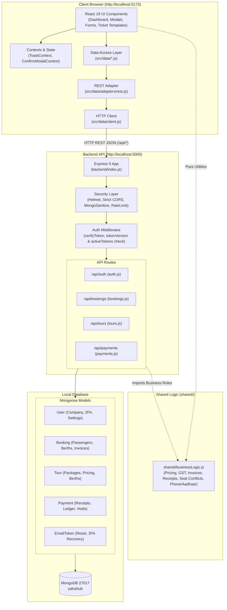

# YatraHub (TBS) — System Architecture

## 1. Overview
YatraHub is an on-premise local web application designed specifically for small Indian bus and yatra tour operators. It manages passenger reservations, sleeper coach seat manifests, GST invoices, multi-installment payment ledgers, QR boarding passes, and custom ticket templates.

The application runs strictly in a **local web mode**:
- **Frontend**: React 19 SPA bundled with Vite, styled with Tailwind CSS.
- **Backend API**: Node.js with Express 5 REST API.
- **Database**: Local MongoDB instance (`mongodb://127.0.0.1:27017/yatrahub`) using Mongoose 8 ODM.
- **Shared Core**: Pure JavaScript ESM module (`shared/businessLogic.js`) shared between frontend and backend.

---

## 2. System Architecture Diagram

---

## 3. Frontend Architecture

### 3.1 Directory Structure
- `src/components/`: Modular React components.
  - `src/components/dashboard/`: Dashboard layout, sidebar navigation, top header, home statistics, settings panel, and invoice management modals.
  - `src/components/common/`: Shared UI components including `BoardingPassModal`, `SeatLayoutModal`, `ReceiptModal`, `ConfirmModalContext`, and `ToastContext`.
  - `src/components/tickets/`: Ticket template registry and 6 modular printable ticket styles (`classic`, `modern`, `heritage`, `corporate`, `thermal`, `transit`).
  - `src/components/BookingForm.jsx`: New reservation interface with interactive sleeper bus berth selector.
  - `src/components/InvoiceView.jsx`: Printable GST tax invoice with company branding, passenger table, and bank/UPI payment counterfoil.
  - `src/components/JourneyManager.jsx`: Bus departure coordination, manifest status, batch boarding, seat swap, and quick balance collection.
  - `src/components/PaymentTracker.jsx`: Multi-installment payment ledger, payment recording, and receipt voucher generation.
  - `src/components/TourInventory.jsx`: Tour package management, coach type configuration, and berth pricing.
  - `src/components/TourAnalytics.jsx`: Revenue metrics, booking statistics, and occupancy analytics.
- `src/data/`: Centralized Data Access Layer (DAL). Components never execute raw `fetch()` calls; all requests route through:
  - `src/data/client.js`: HTTP request wrapper with bearer token injection and error handling.
  - `src/data/adapters/index.js` & `src/data/adapters/rest.js`: REST adapter converting backend JSON into normalized application entities.
  - Domain modules: `src/data/auth.js`, `src/data/bookings.js`, `src/data/tours.js`, `src/data/payments.js`, `src/data/settings.js`.
- `src/i18n/`: Internationalization dictionaries (`documents.js`) offering complete translation parity across English (`en`), Hindi (`hi`), and Gujarati (`gu`).
- `src/utils/`: Pure helpers for dates, currency formatting, CSV generation (`csv.js`), seat auto-allocation (`seatAssignment.js`), and validators (`validators.js`).

---

## 4. Shared Business Logic (`shared/businessLogic.js`)

Core financial and domain rules are centralized in a zero-dependency ESM module imported directly by both frontend and backend:

| Function | Purpose |
| :--- | :--- |
| `round2(num)` | Standardizes 2-decimal rupee rounding using `Number.EPSILON`. |
| `calculatePricing(...)` | Recomputes pricing, discounts (fixed / percentage), and 5% GST (tax-inclusive or exclusive). |
| `generateTourCode(tourName)` | Extracts uppercase 3-letter acronyms (e.g. "Dwarka Somnath" → "DSX"). |
| `getMonthCode(date)` | Returns 3-letter month code (e.g. "OCT"). |
| `buildInvoicePrefix(customPrefix, tourName, journeyDate)` | Constructs single-source invoice prefixes (e.g. "YHB-DSX-OCT-"). |
| `calculateNextInvoiceNo(existingInvoices, prefix)` | Calculates zero-collision sequential invoice counters (e.g. "YHB-DSX-OCT-001"). |
| `buildReceiptPrefix(customPrefix, date)` | Builds payment voucher prefixes (e.g. "REC-2610-"). |
| `calculateNextReceiptNo(existingReceipts, prefix)` | Calculates sequential payment receipt numbers (e.g. "REC-2610-001"). |
| `getDayBounds(dateInput)` | Normalizes journey dates to UTC start and end bounds to avoid timezone misalignment. |
| `validateIndianPhone(phone)` | Validates 10-digit Indian mobile numbers (starting with 6, 7, 8, or 9). |
| `validateAadhaar(aadhar)` | Validates 12-digit Indian Aadhaar number format. |
| `calculateCancellationRefund(...)` | Validates cancellation charges and calculates customer refunds. |
| `computeLedgerTotals(payments, totalAmount)` | Calculates total received, total refunded, and remaining balance from ledger entries. |
| `findSeatConflicts(...)` | Detects internal and cross-booking seat collisions for the same tour and journey date. |

---

## 5. Backend Architecture (Express 5)

### 5.1 Server Configuration (`backend/index.js`)
- Initializes Express application with JSON body parser.
- Enables CORS for local frontend ports (`http://localhost:5173`).
- Connects to local MongoDB database (`mongodb://127.0.0.1:27017/yatrahub`).
- Manages startup index synchronization for the `Booking` collection.

### 5.2 Middleware (`backend/middleware/auth.js`)
- `verifyToken`: Extracts Bearer token from `Authorization` header, verifies signature against `process.env.JWT_SECRET`, and confirms token existence in `user.activeTokens` to enforce session validity and logout invalidation.

### 5.3 Routes
1. **`/api/auth`** (`backend/routes/auth.js`):
   - Operator registration and password login.
   - TOTP 2-Factor Authentication setup, verification, and disablement.
   - Password reset via email token (`nodemailer`).
   - 2FA recovery flow.
   - Active session listing and per-device revocation.
   - Company branding, logo, invoice prefixes, and bank detail updates.
2. **`/api/bookings`** (`backend/routes/bookings.js`):
   - Reservation CRUD, soft-deletion, and restoration.
   - Conflict-guarded seat reservations.
   - Passenger check-in toggle and batch check-in.
   - Seat swap operations.
   - Booking cancellations with automated refund voucher creation.
3. **`/api/tours`** (`backend/routes/tours.js`):
   - Tour package catalog, departure scheduling, bus layout types, and berth pricing.
4. **`/api/payments`** (`backend/routes/payments.js`):
   - Multi-installment payment recording.
   - Receipt generation and sequential voucher numbers (`REC-XXXX`).
   - Payment voiding with reason tracking and automated balance recalculation.

---

## 6. Database Models (Mongoose)

### 6.1 `User`
- Operator profile (`userName`, `email`, `password` hash).
- 2FA configuration (`twoFactorSecret`, `twoFactorEnabled`).
- Company branding (`companyName`, `companyTagline`, `companyLogo`, `gstNumber`, `companyPhone`, `companyHeadquarters`).
- Operational settings (`invoicePrefix`, `receiptPrefix`, `invoiceTheme`, `invoiceColor`, `documentLanguage`, `ticketTemplate`, `termsAndConditions`).
- Financial details (`bankDetails`: account name, account number, IFSC, bank name, UPI ID).
- Conductor / organizer contact directory (`organizers`).
- Active session whitelist (`activeTokens`).

### 6.2 `Booking`
- User ownership (`userId`).
- Identification (`invoiceNo`, `date`, `tourName`, `journeyDate`, `busType`, `duration`).
- Customer contact (`contactName`, `contactPhone`, `contactEmail`).
- Financials (`totalAmount`, `advanceReceived`, `discount`, `discountType`, `gstRate`, `taxAmount`, `isTaxInclusive`, `isPaid`, `paymentMode`).
- Passenger roster (`passengers`: array of name, age, gender, city, seatId, aadhar, checkedIn).
- Cancellation ledger (`status`, `cancellationReason`, `cancellationCharge`, `refundAmount`, `refundPaymentMode`, `cancelledAt`).
- Soft-delete tracking (`deletedAt`).

### 6.3 `Tour`
- Operator ownership (`userId`).
- Package details (`name`, `duration`, `busType`, `journeyDate`).
- Berth pricing model (`pricingType`, `fixedPrice`, `lowerPrice`, `upperPrice`).

### 6.4 `Payment`
- Operator and booking association (`userId`, `bookingId`).
- Transaction details (`receiptNo`, `amount`, `type`: advance/partial/balance/refund, `paymentMode`, `paymentDate`, `referenceNo`, `notes`, `recordedBy`).
- Audit trail (`isVoid`, `voidReason`, `voidedAt`, `voidedBy`).

### 6.5 `EmailToken`
- Token storage (`userId`, `token`: SHA-256 hashed, `purpose`: password-reset / 2fa-recovery, `expiresAt`).

### 6.6 `Counter`
- Atomic sequence generation for invoice and receipt numbers (`userId`, `prefix`, `seq`).

### 6.7 `AuditLog`
- Security event ledger (`userId`, `action`, `ip`, `userAgent`, `meta`, `createdAt` with 180-day TTL).

---

## 7. Security Hardening Architecture (Phase 2)

- **Strict Output Encoding & CSP**: All user inputs rendered in ticket templates, invoices, and boarding passes are escaped via `escapeHtml()`, and strict Content-Security-Policy headers/meta tags block inline scripts and remote resources.
- **Server Authority Over Pricing & Seats**: The server recomputes tour rates, discounts, and 5% GST using `calculatePricing()`, rejecting client price tampering. The `Payment` ledger is the sole source of truth for booking financial synchronization (`syncBookingPayments()`).
- **Cryptographic Protection at Rest**:
  - TOTP 2FA secrets are encrypted at rest with AES-256-GCM (`TOTP_ENC_KEY`).
  - Passenger 12-digit Indian Aadhaar numbers are encrypted at rest with AES-256-GCM (`DATA_ENC_KEY`) and validated via the Verhoeff checksum algorithm. Responses return masked values (`XXXX XXXX 1234`) with an authorized reveal endpoint.
- **Session Hardening & Defense-in-Depth**:
  - `httpOnly`, `SameSite=Strict` session cookies with custom `X-Requested-With` header verification for CSRF mitigation.
  - Active session invalidation via per-user `tokenVersion` and `activeTokens` tracking.
  - Brute-force protection: Rate limiting on auth endpoints (10 req/15min) and 15-minute account lockouts after 5 consecutive failed attempts.
  - Password complexity policy: Minimum 10 characters, upper, lower, digit, symbol.
- **API Defense & Auditing**:
  - `helmet` security headers (`X-Content-Type-Options: nosniff`, `X-Frame-Options: SAMEORIGIN`, HSTS).
  - CORS strictly restricted to configured `FRONTEND_URL`.
  - Express 5-compatible NoSQL sanitizer (`mongoSanitize`) and Zod schema validation.
  - Payload limits: Strict 100KB global limit with route-specific 5MB limit for logo uploads.
  - Immutable audit trail (`AuditLog`) capturing sensitive operational events with PII-masked console logging.

---

## 8. UI Foundation (Design System v2 — Part 3.1)

- **Design Tokens (`src/index.css`)**: Semantic `--yh-*` CSS custom properties for Light (`:root`) and Dark (`[data-theme="dark"]`) themes mapped into Tailwind CSS 4 via `@theme` (Deep Indigo primary, warm Saffron/Amber accent, warm-tinted neutrals, WCAG AA semantic pairs, radii, shadows, z-index scale, and reduced-motion guards). Legacy CSS variables remain intact while screens migrate incrementally across Parts 3.2–3.5.
- **Offline Multi-Script Typography (`src/main.jsx`)**: Self-hosted `@fontsource-variable/inter` paired with `@fontsource/noto-sans-devanagari` and `@fontsource/noto-sans-gujarati` (weights 400–700) bundled directly into `dist/assets/` with zero external font CDNs.
- **Theme Handling (`src/theme/` + `public/theme-init.js`)**:
  - `public/theme-init.js` loads synchronously from `'self'` in `index.html` `<head>` before first paint to eliminate light/dark FOUC without loosening CSP.
  - `ThemeProvider` and `useTheme` support `"system"`, `"light"`, and `"dark"` modes, reacting to OS `prefers-color-scheme` changes and wrapping all `localStorage` access in `try/catch`.
- **Accessible UI Primitives (`src/components/ui/`)**: 25 token-driven, accessible primitives (`Button`, `IconButton`, `Input`, `Select`, `Textarea`, `Checkbox`, `Switch`, `Field`, `Card`, `Badge`, `StatusPill`, `Modal`/`Dialog`, `Drawer`, `Tabs`, `Table`, `Tooltip`, `Skeleton`, `EmptyState`, `Spinner`, `StatCard`, `PageHeader`, `SearchInput`, `Avatar`, `ConfirmDialog`, `Toast`) built with `class-variance-authority`, `clsx`, and `tailwind-merge`, plus `src/utils/cn.js` and `formatINR` (`src/utils/formatters.js`).
- **Toast & Confirm Providers (`src/components/common/`)**: Refactored into separate hook (`useToast.js`, `useConfirm.js`), provider (`ToastProvider.jsx`, `ConfirmModalProvider.jsx`), and `.js` compatibility barrels (`ToastContext.js`, `ConfirmModalContext.js`) backed by the new `Toast` and `ConfirmDialog` primitives.
- **Dev-Only UI Kit (`src/dev/UiKitPage.jsx`)**: Reachable at `#/ui-kit` strictly when `import.meta.env.DEV` is true and dead-code-eliminated from production builds.

---

## 9. App Shell, Navigation & Code Splitting (Part 3.2)

- **App Shell (`src/components/shell/`)**:
  - `AppShell.jsx`: Provides the "Skip to main content" link (first focusable element), `aria-live="polite"` route announcements, focus management onto `#main-content` (`tabIndex={-1}`) on tab change, and conditional `<PageHeader>` slot (deferred via `hasOwnHeading: true` for screens that still render their own heading until Parts 3.3–3.5).
  - `AppSidebar.jsx`: Desktop (`lg+`) collapsible sidebar (`w-64` expanded / `w-[76px]` collapsed) persisting collapsed state via `try/catch`-wrapped `localStorage`, company logo with `Avatar` fallback, active bar + bold state + `aria-current="page"`, tooltips when collapsed, and hover/focus route prefetching.
  - `AppTopBar.jsx`: Sticky header showing page title, global search (`SearchInput`), prominent **"New Booking"** CTA reachable from every screen, gated `ThemeSwitcher` (controlled by `SHOW_THEME_TOGGLE = false` in `src/components/shell/shellConfig.js` until Part 3.5 migrates inner screens), and accessible User Menu (Settings, Sign Out).
  - `MobileBottomNav.jsx` + `Drawer`: Mobile/tablet (`<lg`) fixed bottom bar (Overview, Travelers, center Book action, Journeys, More) paired with the focus-trapped, Escape-dismissible `Drawer` primitive for full navigation.
- **Routing Strategy**: Preserves `activeTab` state in `src/components/Dashboard.jsx` (`dashboard`, `passengers`, `journey`, `tours`, `analytics`, `settings`, `form`) without introducing a router library.
- **Lazy Loading & Error Recovery**:
  - `Auth` and `Dashboard` (`AppShell`) load eagerly. All 7 tab screens (`DashboardHome`, `BookingForm`, `PassengerManagement`, `TourInventory`, `JourneyManager`, `TourAnalytics`, `SettingsPanel`), full-screen views (`InvoiceView`, `TwoFactorSetup`, `TwoFactorVerify`, `ResetPassword`, `Recover2FA`), and on-demand modals (`Disable2FAModal`, `InvoicesModal`, `CancelBookingModal`) load via `React.lazy` with page-shaped `PageSkeleton` fallbacks.
  - `ChunkErrorBoundary.jsx` wraps lazy views with a friendly "Could not load this page" card and **Retry** / **Reload App** actions, resetting automatically when switching tabs so the shell remains usable.
- **Vendor Chunk Splitting (`vite.config.js`)**: `build.rollupOptions.output.manualChunks` separates `vendor-react`, `vendor-recharts` (loaded only on Analytics), `vendor-icons`, `vendor-ui`, and `vendor-misc`, reducing the main entry chunk from `1,123 kB` to `~80 kB` with zero chunks exceeding 500 kB.
