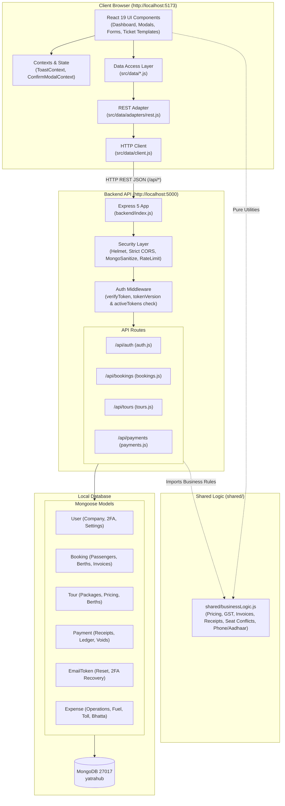

# YatraHub (TBS) — System Architecture

## 1. Overview
YatraHub is an on-premise local web application designed specifically for small Indian bus and yatra tour operators. It manages passenger reservations, sleeper coach seat manifests, GST invoices, multi-installment payment ledgers, QR boarding passes, and custom ticket templates.

The application runs strictly in a **local web mode**:
- **Frontend**: React 19 SPA bundled with Vite, styled with Tailwind CSS.
- **Backend API**: Node.js with Express 5 REST API.
- **Database**: Local MongoDB instance (`mongodb://127.0.0.1:27017/yatrahub`) using Mongoose 8 ODM.
- **Shared Core**: Pure JavaScript ESM module (`shared/businessLogic.js`) shared between frontend and backend.

---

## 2. System Architecture Diagram

---

## 3. Frontend Architecture

### 3.1 Directory Structure
- `src/components/`: Modular React components.
  - `src/components/dashboard/`: Dashboard layout, sidebar navigation, top header, home statistics, settings panel, and invoice management modals.
  - `src/components/common/`: Shared UI components including `BoardingPassModal`, `SeatLayoutModal`, `ReceiptModal`, `ConfirmModalContext`, and `ToastContext`.
  - `src/components/tickets/`: Ticket template registry and 6 modular printable ticket styles (`classic`, `modern`, `heritage`, `corporate`, `thermal`, `transit`).
  - `src/components/BookingForm.jsx`: New reservation interface with interactive sleeper bus berth selector.
  - `src/components/InvoiceView.jsx`: Printable GST tax invoice with company branding, passenger table, and bank/UPI payment counterfoil.
  - `src/components/JourneyManager.jsx`: Bus departure coordination, manifest status, batch boarding, seat swap, and quick balance collection.
  - `src/components/PaymentTracker.jsx`: Multi-installment payment ledger, payment recording, and receipt voucher generation.
  - `src/components/TourInventory.jsx`: Tour package management, coach type configuration, and berth pricing.
  - `src/components/ExpenseTracker.jsx`: Expense management, coach operations costs (fuel, toll, bhatta, maintenance), category breakdown (Recharts), responsive desktop table / mobile cards, collapsible filter bar, CSV export, duplicate, and soft delete.
  - `src/components/TourAnalytics.jsx`: Revenue metrics, booking statistics, and occupancy analytics.
- `src/data/`: Centralized Data Access Layer (DAL). Components never execute raw `fetch()` calls; all requests route through:
  - `src/data/client.js`: HTTP request wrapper with bearer token injection and error handling.
  - `src/data/adapters/index.js` & `src/data/adapters/rest.js`: REST adapter converting backend JSON into normalized application entities.
  - Domain modules: `src/data/auth.js`, `src/data/bookings.js`, `src/data/tours.js`, `src/data/payments.js`, `src/data/expenses.js`, `src/data/settings.js`.
- `src/i18n/`: Internationalization dictionaries (`documents.js`) offering complete translation parity across English (`en`), Hindi (`hi`), and Gujarati (`gu`).
- `src/utils/`: Pure helpers for dates, currency formatting, CSV generation (`csv.js`), seat auto-allocation (`seatAssignment.js`), and validators (`validators.js`).

---

## 4. Shared Business Logic (`shared/businessLogic.js`)

Core financial and domain rules are centralized in a zero-dependency ESM module imported directly by both frontend and backend:

| Function | Purpose |
| :--- | :--- |
| `round2(num)` | Standardizes 2-decimal rupee rounding using `Number.EPSILON`. |
| `calculatePricing(...)` | Recomputes pricing, discounts (fixed / percentage), and 5% GST (tax-inclusive or exclusive). |
| `generateTourCode(tourName)` | Extracts uppercase 3-letter acronyms (e.g. "Dwarka Somnath" → "DSX"). |
| `getMonthCode(date)` | Returns 3-letter month code (e.g. "OCT"). |
| `buildInvoicePrefix(customPrefix, tourName, journeyDate)` | Constructs single-source invoice prefixes (e.g. "YHB-DSX-OCT-"). |
| `calculateNextInvoiceNo(existingInvoices, prefix)` | Calculates zero-collision sequential invoice counters (e.g. "YHB-DSX-OCT-001"). |
| `buildReceiptPrefix(customPrefix, date)` | Builds payment voucher prefixes (e.g. "REC-2610-"). |
| `calculateNextReceiptNo(existingReceipts, prefix)` | Calculates sequential payment receipt numbers (e.g. "REC-2610-001"). |
| `getDayBounds(dateInput)` | Normalizes journey dates to UTC start and end bounds to avoid timezone misalignment. |
| `validateIndianPhone(phone)` | Validates 10-digit Indian mobile numbers (starting with 6, 7, 8, or 9). |
| `validateAadhaar(aadhar)` | Validates 12-digit Indian Aadhaar number format. |
| `calculateCancellationRefund(...)` | Validates cancellation charges and calculates customer refunds. |
| `computeLedgerTotals(payments, totalAmount)` | Calculates total received, total refunded, and remaining balance from ledger entries. |
| `findSeatConflicts(...)` | Detects internal and cross-booking seat collisions for the same tour and journey date. |

---

## 5. Backend Architecture (Express 5)

### 5.1 Server Configuration (`backend/index.js`)
- Initializes Express application with JSON body parser.
- Enables CORS for local frontend ports (`http://localhost:5173`).
- Connects to local MongoDB database (`mongodb://127.0.0.1:27017/yatrahub`).
- Manages startup index synchronization for the `Booking` collection.

### 5.2 Middleware (`backend/middleware/auth.js`)
- `verifyToken`: Extracts Bearer token from `Authorization` header, verifies signature against `process.env.JWT_SECRET`, and confirms token existence in `user.activeTokens` to enforce session validity and logout invalidation.

### 5.3 Routes
1. **`/api/auth`** (`backend/routes/auth.js`):
   - Operator registration and password login.
   - TOTP 2-Factor Authentication setup, verification, and disablement.
   - Password reset via email token (`nodemailer`).
   - 2FA recovery flow.
   - Active session listing and per-device revocation.
   - Company branding, logo, invoice prefixes, and bank detail updates.
2. **`/api/bookings`** (`backend/routes/bookings.js`):
   - Reservation CRUD, soft-deletion, and restoration.
   - Conflict-guarded seat reservations.
   - Passenger check-in toggle and batch check-in.
   - Seat swap operations.
   - Booking cancellations with automated refund voucher creation.
3. **`/api/tours`** (`backend/routes/tours.js`):
   - Tour package catalog, departure scheduling, bus layout types, and berth pricing.
4. **`/api/payments`** (`backend/routes/payments.js`):
   - Multi-installment payment recording.
   - Receipt generation and sequential voucher numbers (`REC-XXXX`).
   - Payment voiding with reason tracking and automated balance recalculation.

---

## 6. Database Models (Mongoose)

### 6.1 `User`
- Operator profile (`userName`, `email`, `password` hash).
- 2FA configuration (`twoFactorSecret`, `twoFactorEnabled`).
- Company branding (`companyName`, `companyTagline`, `companyLogo`, `gstNumber`, `companyPhone`, `companyHeadquarters`).
- Operational settings (`invoicePrefix`, `receiptPrefix`, `invoiceTheme`, `invoiceColor`, `documentLanguage`, `ticketTemplate`, `termsAndConditions`).
- Financial details (`bankDetails`: account name, account number, IFSC, bank name, UPI ID).
- Conductor / organizer contact directory (`organizers`).
- Active session whitelist (`activeTokens`).

### 6.2 `Booking`
- User ownership (`userId`).
- Identification (`invoiceNo`, `date`, `tourName`, `journeyDate`, `busType`, `duration`).
- Customer contact (`contactName`, `contactPhone`, `contactEmail`).
- Financials (`totalAmount`, `advanceReceived`, `discount`, `discountType`, `gstRate`, `taxAmount`, `isTaxInclusive`, `isPaid`, `paymentMode`).
- Passenger roster (`passengers`: array of name, age, gender, city, seatId, aadhar, checkedIn).
- Cancellation ledger (`status`, `cancellationReason`, `cancellationCharge`, `refundAmount`, `refundPaymentMode`, `cancelledAt`).
- Soft-delete tracking (`deletedAt`).

### 6.3 `Tour`
- Operator ownership (`userId`).
- Package details (`name`, `duration`, `busType`, `journeyDate`).
- Berth pricing model (`pricingType`, `fixedPrice`, `lowerPrice`, `upperPrice`).

### 6.4 `Payment`
- Operator and booking association (`userId`, `bookingId`).
- Transaction details (`receiptNo`, `amount`, `type`: advance/partial/balance/refund, `paymentMode`, `paymentDate`, `referenceNo`, `notes`, `recordedBy`).
- Audit trail (`isVoid`, `voidReason`, `voidedAt`, `voidedBy`).

### 6.5 `EmailToken`
- Token storage (`userId`, `token`: SHA-256 hashed, `purpose`: password-reset / 2fa-recovery, `expiresAt`).

### 6.6 `Counter`
- Atomic sequence generation for invoice and receipt numbers (`userId`, `prefix`, `seq`).

### 6.7 `AuditLog`
- Security event ledger (`userId`, `action`, `ip`, `userAgent`, `meta`, `createdAt` with 180-day TTL).

---

## 7. Security Hardening Architecture (Phase 2)

- **Strict Output Encoding & CSP**: All user inputs rendered in ticket templates, invoices, and boarding passes are escaped via `escapeHtml()`, and strict Content-Security-Policy headers/meta tags block inline scripts and remote resources.
- **Server Authority Over Pricing & Seats**: The server recomputes tour rates, discounts, and 5% GST using `calculatePricing()`, rejecting client price tampering. The `Payment` ledger is the sole source of truth for booking financial synchronization (`syncBookingPayments()`).
- **Cryptographic Protection at Rest**:
  - TOTP 2FA secrets are encrypted at rest with AES-256-GCM (`TOTP_ENC_KEY`).
  - Passenger 12-digit Indian Aadhaar numbers are encrypted at rest with AES-256-GCM (`DATA_ENC_KEY`) and validated via the Verhoeff checksum algorithm. Responses return masked values (`XXXX XXXX 1234`) with an authorized reveal endpoint.
- **Session Hardening & Defense-in-Depth**:
  - `httpOnly`, `SameSite=Strict` session cookies with custom `X-Requested-With` header verification for CSRF mitigation.
  - Active session invalidation via per-user `tokenVersion` and `activeTokens` tracking.
  - Brute-force protection: Rate limiting on auth endpoints (10 req/15min) and 15-minute account lockouts after 5 consecutive failed attempts.
  - Password complexity policy: Minimum 10 characters, upper, lower, digit, symbol.
- **API Defense & Auditing**:
  - `helmet` security headers (`X-Content-Type-Options: nosniff`, `X-Frame-Options: SAMEORIGIN`, HSTS).
  - CORS strictly restricted to configured `FRONTEND_URL`.
  - Express 5-compatible NoSQL sanitizer (`mongoSanitize`) and Zod schema validation.
  - Payload limits: Strict 100KB global limit with route-specific 5MB limit for logo uploads.
  - Immutable audit trail (`AuditLog`) capturing sensitive operational events with PII-masked console logging.

---

## 8. UI Foundation (Design System v2 — Part 3.1)

- **Design Tokens (`src/index.css`)**: Semantic `--yh-*` CSS custom properties for Light (`:root`) and Dark (`[data-theme="dark"]`) themes mapped into Tailwind CSS 4 via `@theme` (Deep Indigo primary, warm Saffron/Amber accent, warm-tinted neutrals, WCAG AA semantic pairs, radii, shadows, z-index scale, and reduced-motion guards). Legacy CSS variables remain intact while screens migrate incrementally across Parts 3.2–3.5.
- **Offline Multi-Script Typography (`src/main.jsx`)**: Self-hosted `@fontsource-variable/inter` paired with `@fontsource/noto-sans-devanagari` and `@fontsource/noto-sans-gujarati` (weights 400–700) bundled directly into `dist/assets/` with zero external font CDNs.
- **Theme Handling (`src/theme/` + `public/theme-init.js`)**:
  - `public/theme-init.js` loads synchronously from `'self'` in `index.html` `<head>` before first paint to eliminate light/dark FOUC without loosening CSP.
  - `ThemeProvider` and `useTheme` support `"system"`, `"light"`, and `"dark"` modes, reacting to OS `prefers-color-scheme` changes and wrapping all `localStorage` access in `try/catch`.
- **Accessible UI Primitives (`src/components/ui/`)**: 25 token-driven, accessible primitives (`Button`, `IconButton`, `Input`, `Select`, `Textarea`, `Checkbox`, `Switch`, `Field`, `Card`, `Badge`, `StatusPill`, `Modal`/`Dialog`, `Drawer`, `Tabs`, `Table`, `Tooltip`, `Skeleton`, `EmptyState`, `Spinner`, `StatCard`, `PageHeader`, `SearchInput`, `Avatar`, `ConfirmDialog`, `Toast`) built with `class-variance-authority`, `clsx`, and `tailwind-merge`, plus `src/utils/cn.js` and `formatINR` (`src/utils/formatters.js`).
- **Toast & Confirm Providers (`src/components/common/`)**: Refactored into separate hook (`useToast.js`, `useConfirm.js`), provider (`ToastProvider.jsx`, `ConfirmModalProvider.jsx`), and `.js` compatibility barrels (`ToastContext.js`, `ConfirmModalContext.js`) backed by the new `Toast` and `ConfirmDialog` primitives.
- **Dev-Only UI Kit (`src/dev/UiKitPage.jsx`)**: Reachable at `#/ui-kit` strictly when `import.meta.env.DEV` is true and dead-code-eliminated from production builds.

---

## 9. App Shell, Navigation & Code Splitting (Part 3.2)

- **App Shell (`src/components/shell/`)**:
  - `AppShell.jsx`: Provides the "Skip to main content" link (first focusable element), `aria-live="polite"` route announcements, focus management onto `#main-content` (`tabIndex={-1}`) on tab change, and conditional `<PageHeader>` slot (deferred via `hasOwnHeading: true` for screens that still render their own heading until Parts 3.3–3.5).
  - `AppSidebar.jsx`: Desktop (`lg+`) collapsible sidebar (`w-64` expanded / `w-[76px]` collapsed) persisting collapsed state via `try/catch`-wrapped `localStorage`, company logo with `Avatar` fallback, active bar + bold state + `aria-current="page"`, tooltips when collapsed, and hover/focus route prefetching.
  - `AppTopBar.jsx`: Sticky header showing page title, global search (`SearchInput`), prominent **"New Booking"** CTA reachable from every screen, gated `ThemeSwitcher` (controlled by `SHOW_THEME_TOGGLE = false` in `src/components/shell/shellConfig.js` until Part 3.5 migrates inner screens), and accessible User Menu (Settings, Sign Out).
  - `MobileBottomNav.jsx` + `Drawer`: Mobile/tablet (`<lg`) fixed bottom bar (Overview, Travelers, center Book action, Journeys, More) paired with the focus-trapped, Escape-dismissible `Drawer` primitive for full navigation.
- **Routing Strategy**: Preserves `activeTab` state in `src/components/Dashboard.jsx` (`dashboard`, `passengers`, `journey`, `tours`, `analytics`, `settings`, `form`) without introducing a router library.
- **Lazy Loading & Error Recovery**:
  - `Auth` and `Dashboard` (`AppShell`) load eagerly. All 7 tab screens (`DashboardHome`, `BookingForm`, `PassengerManagement`, `TourInventory`, `JourneyManager`, `TourAnalytics`, `SettingsPanel`), full-screen views (`InvoiceView`, `TwoFactorSetup`, `TwoFactorVerify`, `ResetPassword`, `Recover2FA`), and on-demand modals (`Disable2FAModal`, `InvoicesModal`, `CancelBookingModal`) load via `React.lazy` with page-shaped `PageSkeleton` fallbacks.
  - `ChunkErrorBoundary.jsx` wraps lazy views with a friendly "Could not load this page" card and **Retry** / **Reload App** actions, resetting automatically when switching tabs so the shell remains usable.
  - `PanelErrorBoundary.jsx` (`src/components/common/PanelErrorBoundary.jsx`): Granular error boundary wrapping individual sub-panels (e.g. Journeys "Coaches & Departures" vs "Boarding Manifest", Settings tabs). If a runtime crash occurs inside a specific panel, it renders a scoped inline error card ("Something went wrong in this panel") with "Retry" and "Reload App" buttons, leaving the surrounding screen, top bar, and navigation tabs completely functional. Resets automatically on tab change via `resetKey`.
- **Toast Notifications & StrictMode Deduplication (`src/components/common/ToastProvider.jsx`)**:
  - Maintained with a 3-second deduplication cache (`recentToastsRef`) to suppress duplicate `(type, message)` alerts emitted within 3000ms. Eliminates double-toast flashes triggered by React 19 DEV `StrictMode` double-invocation of effects.
  - `ToastContainer` anchored to `bottom-[calc(4.5rem+env(safe-area-inset-bottom))] lg:bottom-5` to ensure notifications never occlude `MobileBottomNav` on mobile and tablet viewports.
- **Vendor Chunk Splitting (`vite.config.js`)**: `build.rollupOptions.output.manualChunks` separates `vendor-react`, `vendor-recharts` (loaded only on Analytics), `vendor-icons`, `vendor-ui`, and `vendor-misc`, reducing the main entry chunk from `1,123 kB` to `~80 kB` with zero chunks exceeding 500 kB.

---

## 10. Dashboard Overview & Stepped Booking Flow (Part 3.3)

- **Shell PageHeader Ownership (`src/components/shell/shellConfig.js`)**: Flipped `hasOwnHeading: false` for both `dashboard` and `form` so `AppShell` renders the single screen `<h1>` (`Overview`, `New Booking`, `Edit Booking`), paired with mobile safe-area bottom padding (`pb-[calc(5.5rem+env(safe-area-inset-bottom))]`) so cards and sticky form bars never sit behind `MobileBottomNav`.
- **Dashboard Overview (`src/components/dashboard/DashboardHome.jsx`, `src/utils/dashboardOverview.js`, overview section of `src/components/PaymentTracker.jsx`)**:
  - Pure metrics/grouping helpers (`computeOverviewMetrics`, `groupUpcomingDepartures`, `filterRecentBookings`, `getBookingPaymentStatus`, `getPaymentUrgencyMeta`) separated into `src/utils/dashboardOverview.js`.
  - Token-driven Today's Operations card, 4-card KPI row (`StatCard` + `Skeleton` loading states), Upcoming 7-Day Departures with accessible berth occupancy progress bars (`role="progressbar"` + `"X of Y berths booked, Z%"`), responsive Recent Bookings (`Table` on `md+`, stacked cards on `<md`) composing global top-bar search (`filteredBookings`) with local status chips and search, and standardized Payment Tracking overview cards with text+icon+color urgency badges (leaving PaymentTracker's modals untouched for Part 3.4).
- **Stepped Booking Flow (`src/components/BookingForm.jsx`, `src/utils/bookingFormHelpers.js`)**:
  - Structured into 4 accessible steps (**1. Tour & Date + Primary Contact**, **2. Passengers & Seats**, **3. Pricing & Payment**, **4. Review**) with `aria-current="step"`, `aria-live="polite"` step announcements, inline `<Field>` errors, per-step error summary, and focus movement to the first invalid field.
  - Full cross-step validation runs before save (using untouched `calculatePricing` in `src/utils/pricing.js` and `isValidIndianPhone`/`isValidAadhaar` in `src/utils/validators.js`). Review step masks passenger Aadhaar via `maskAadhaar()`.
  - `Dashboard.jsx`'s `handleSaveBooking` returns a structured `{ ok, booking | error, status, data }` result so `BookingForm` surfaces authoritative server HTTP 400/409 errors (seat conflicts, total mismatches, advance bounds) in a top-of-form `role="alert"` banner while preserving all entered user data.

---

## 11. Operational Modals & Journeys Screen (Part 3.4)

- **Operational Modals Migration to `Modal` Primitive**:
  - `src/components/common/SeatLayoutModal.jsx`: Fully migrated from hardcoded `fixed inset-0` overlays to the accessible `Modal` primitive with focus trapping, Escape dismissal, and body scroll lock. Tokenized deck navigation (Lower/Upper tabs), WCAG AA color-coded berth legend, and human-readable berth labels via `formatSeatLabel`. All print/export functions (`printSeatLayout`, CSV) remain untouched with strict output escaping.
  - `src/utils/seatFormatting.js` (re-exported in `src/utils/formatters.js`): Pure, testable formatting utilities (`formatSeatLabel`, `formatSeatList`). Parses sleeper berth codes (`"lower-L1-1"` → `"Lower L1-1"`, `"upper-R2-2"` → `"Upper R2-2"`) with case normalization and robust fallback safety; formats multi-seat lists with overflow truncation (`"Lower L1-1, Upper R2-2 +2"`).
  - `BookingForm.jsx` Auto-Assign Modal: Rebuilt on `Modal` with deck preference radios and accessible capacity checks.
  - `src/components/PaymentTracker.jsx` Modals: Record Payment and Payment Ledger migrated to `Modal`, `Table`, `Field`, `Input`, `Select`, and `StatusPill`. Void payment dialog migrated to a dedicated destructive confirmation prompt on `Modal`.
  - `src/components/dashboard/CancelBookingModal.jsx`: Rebuilt on `Modal` with real-time refund calculation (`Math.max(0, totalPaid - fee)`), bounds checking, preset buttons (₹0 fee for full refund, Retain All for ₹0 refund), clear seat release warning, and top `role="alert"` banner for server errors.
  - `src/components/dashboard/InvoicesModal.jsx`: Rebuilt on `Modal` (`size="xl"`), sticky toolbar featuring `SearchInput`, tour filter `Select`, and status filter chips (`All`, `Paid`, `Pending`, `Cancelled`) with `aria-pressed`. Desktop view (`md+`) renders accessible `Table` with invoice number, status pill, traveler name/phone, tour badge, journey date, passenger count, total amount (`formatINR`), and action icon buttons. Mobile view (`<md`) renders responsive stacked cards with `min-h-11` touch targets. Filter misses render `EmptyState`.
- **Journeys Screen (`src/components/JourneyManager.jsx`)**:
  - Integrated into the AppShell heading hierarchy with `journey.hasOwnHeading: false` in `src/components/shell/shellConfig.js`, enabling the shell `<PageHeader>` to render a single `Journeys` `<h1>`.
  - Departure cards tokenized with accessible `role="progressbar"` (`aria-valuenow`, `aria-valuemin`, `aria-valuemax`, `aria-label`), departure status badges, and bus occupancy rates.
  - Boarding checklist with mobile card layout and desktop table layout, passenger check-in toggles, seat swap modal on `Modal`, and quick payment collection on `Modal`. All print/export manifest documents remain untouched with strict output escaping.
- **App Shell Header Polish (`src/components/shell/AppTopBar.jsx` & `AppShell.jsx`)**:
  - Added `hideTitleOnDesktop` prop to `AppTopBar.jsx` bound to `!pageMeta.hasOwnHeading`. On `lg+` viewports when `PageHeader` renders the page title in `<main>`, the duplicate top-bar title is hidden via `lg:hidden`, while remaining visible on mobile viewports (`<lg`).

  - Sticky live summary column on `lg+` and collapsible summary bar docked above the sticky step footer on `<lg`. Existing coach seat picker and auto-assign modals remain functionally intact for Part 3.4 restyling.

---

## 12. Remaining Screens, Auth & Dark Theme System (Part 3.5)

- **Travelers Screen (`src/components/PassengerManagement.jsx`)**:
  - Rebuilt with Design System v2 tokens, eliminating legacy hardcoded borders, shadows, and raw colors.
  - Heading ownership flipped: `passengers.hasOwnHeading: false` in `src/components/shell/shellConfig.js` so `AppShell` renders the unified `<h1>Travelers</h1>`.
  - Search toolbar with `SearchInput`, tour filter `Select`, and boarding status chips (`All`, `Boarded`, `Pending`).
  - Sensitive PII Protection: Masked Aadhaar display (`XXXX XXXX 1234`) with explicit "Reveal" action invoking `client.revealAadhaar(id)` and rendering in an accessible `Modal` dialog.
  - Safe CSV Export: RFC4180-compliant with UTF-8 BOM, spreadsheet formula injection neutralization (`=`, `+`, `-`, `@`), and sanitized passenger fields.
  - Accessible Manifest Print: Focus-managed print modal reusing `ticketRegistry` / print manifest templates with strict output escaping.
  - Responsive layout: Accessible `Table` on desktop (`md+`), touch-friendly stacked cards with large touch targets on mobile (`<md`). Filter misses render `EmptyState`.
- **Destinations Screen (`src/components/TourInventory.jsx`)**:
  - Heading ownership flipped: `tours.hasOwnHeading: false` so `AppShell` renders `<h1>Destinations & Packages</h1>`.
  - Package catalog cards tokenized with bus type badges, departure date, duration, pricing badges (`formatINR`), and action menus.
  - Create / Edit Tour Modal rebuilt on `Modal` primitive with `<Field>`, `<Input>`, `<Select>`, and dynamic pricing breakdown (`Fixed` vs `Per-Berth Lower/Upper`).
  - Live Invoice Prefix Preview: Real-time preview of sequential invoice codes (e.g. `YHB-DSX-NOV-001`) as tour name or prefix is typed via `getInvoicePreview`.
  - Delete tour confirmation using `useConfirm` / `ConfirmDialog` primitive.
- **Analytics Screen (`src/components/TourAnalytics.jsx`)**:
  - Heading ownership flipped: `analytics.hasOwnHeading: false` so `AppShell` renders `<h1>Analytics & Reports</h1>`.
  - KPI Stat Row: 4 responsive `StatCard`s with `formatINR` Indian rupee formatting (Total Revenue, Total Bookings, Passenger Count, Average Occupancy %).
  - Recharts Visualizations: Revenue trend area chart, tour performance bar chart, and payment status pie chart using CSS custom property tokens (`--yh-brand`, `--yh-success`, `--yh-warning`, `--yh-danger`, `--yh-text-primary`, `--yh-border-default`) for dark mode support.
  - Screen Reader Accessibility: Hidden accessible data tables (`sr-only`) accompanying every chart with full numeric data breakdown for assistive technologies.
  - Destination Performance: Accessible desktop `Table` and mobile stacked cards with revenue, booking count, and occupancy progress bars.
- **Settings Screen (`src/components/dashboard/SettingsPanel.jsx`)**:
  - Heading ownership flipped: `settings.hasOwnHeading: false` so `AppShell` renders `<h1>Settings</h1>`.
  - Tabbed Navigation: Built on `Tabs` primitive across 7 structured sections:
    1. Company Profile (name, tagline, GST, phone, address, conductor directory)
    2. Branding & Logo (secure upload with 5MB validation, instant preview, remove logo)
    3. Bank & UPI Details (account name, number, IFSC, bank name, UPI ID for invoices)
    4. Document & Invoice Numbering (invoice prefix, receipt prefix, document language)
    5. Ticket Templates (visual selector for 6 styles: Classic, Modern, Heritage, Corporate, Thermal, Transit)
    6. Terms & Conditions (custom operator booking terms rendered on invoices and tickets)
    7. Security & 2FA (TOTP two-factor status, QR code setup, active sessions revocation, password change)
  - Sticky Unsaved Changes Bar: Visual alert bar at bottom of panel with Save Changes and Discard actions when changes are pending.
- **Authentication & Security Screens**:
  - Redesigned with Design System v2 tokens and responsive card wrappers:
    - `Auth.jsx`: Login & Register forms with accessible inputs, `autoComplete` attributes, show/hide password toggles, real-time password complexity checklist (`checkPasswordCriteria`: ≥10 chars, upper, lower, digit, symbol), and user-friendly server error formatting (`formatAuthError`).
    - `TwoFactorVerify.jsx`: 6-digit numeric TOTP input with auto-focus and 2FA recovery link.
    - `TwoFactorSetup.jsx`: Step-by-step QR code scan, secret key copy with feedback, and verification code test.
    - `Recover2FA.jsx`: Email recovery code request and verification.
    - `ResetPassword.jsx`: Secure password reset with password complexity validation.
    - `Disable2FAModal.jsx`: Destructive action confirmation with password verification on `Modal`.
- **App-Wide States**:
  - 404 Route (`NotFoundPage.jsx`): User-friendly error page with "Back to Overview" CTA when route is invalid.
  - Root Error Boundary (`RootErrorBoundary.jsx`): Catches top-level uncaught React rendering exceptions, displaying a polished error fallback with Reload and Retry actions without white-screening.
  - API Unreachable Banner (`AppShell.jsx`): Subscribes to API connectivity events (`API_STATUS_EVENT` via `subscribeApiStatus` in `src/data/client.js`) and renders an accessible top banner when backend is offline/unreachable, automatically clearing when connection is restored.
- **Dark Theme Toggle & Print Isolation**:
  - Activated: `SHOW_THEME_TOGGLE = true` in `src/components/shell/shellConfig.js`.
  - Complete token coverage: Every screen, modal, card, table, and form element now uses `--yh-*` tokens.
  - Print Isolation (`src/index.css`): Strict `@media print` rules enforcing `background: white !important; color: black !important;` on `body`, `[data-theme="dark"]`, and `.dark` containers, ensuring ticket templates, invoices, receipts, and manifests print cleanly on paper regardless of active dark mode.

---

## 13. Quality Engineering & Phase 3 Verification (Part 3.6)

- **Design System v2 Token Completion & CSS Cleanup**:
  - All coach seat picker layouts (`BookingForm.jsx`), seat indicators, and modals fully migrated to `--yh-*` tokens and accessible primitives.
  - Redundant `tailwind.config.js` safely eliminated; Tailwind CSS 4 compiles standalone via `@import "tailwindcss";` and `@theme` definitions in `src/index.css`.
  - Legacy CSS variables (`--background`, `--foreground`, `--card`, `--popover`, `--border`, `--destructive`, `--chart-*`, etc.) cleaned up, with shorthand compatibility aliases mapped to canonical design system tokens.
- **Accessibility & Static Analysis (eslint-plugin-jsx-a11y)**:
  - Added `eslint-plugin-jsx-a11y` flat recommended configuration into `eslint.config.js`.
  - Systematically resolved all 24 JSX accessibility violations across forms, modals, drawers, tooltips, and tables, achieving 0 errors and 0 warnings.
  - Keyboard accessibility: Standardized `tabIndex={0}` on scrollable tables, managed focus on dialog openings, eliminated autofocus disruption, and isolated backdrop click overlays with `aria-hidden="true"`.
- **Automated UI Smoke & Axe Core Verification (`scripts/ui-smoke.mjs`)**:
  - Added `npm run ui:smoke` command executing Playwright-based headless browser traversal with `@axe-core/playwright`.
  - Audits all 8 application views (Overview, Travelers, Journeys, Destinations, Analytics, Settings, Booking Form, Dev UI Kit) across 4 standard viewports (360px mobile, 768px tablet, 1024px desktop, 1440px wide) in both Light and Dark themes.
  - Validates zero horizontal scrolling (`scrollWidth <= clientWidth`), captures full-page visual screenshots, and produces an axe-core WCAG 2.1 AA violation report in `docs/screenshots/report.md`.
- **Security & PII Hardening (SEC-012 Single Passenger Reconciliation)**:
  - Reconciled both `aadhar` and legacy `aadhaar` field keys on granular passenger updates (`PUT /:bookingId/passengers/:passengerIdentifier`), enforcing AES-256-GCM encryption on newly submitted 12-digit numbers while preserving existing ciphertexts when masked or unchanged.
  - Enforced `maskBookingPaxAadhaar(booking)` across all single/batch passenger updates and status routes (`checkin`, `batch-checkin`, `toggle-payment`, `cancel`, `restore`) to eliminate ciphertext leakage.
- **Dependency & Audit Baseline**:
  - Zero vulnerabilities across root and backend npm dependencies (`npm audit` and `npm audit --omit=dev` reporting 0 vulnerabilities).
  - 223 automated test cases passing across 58 TAP test suites covering business logic, pricing, crypto, tokens, auth, UI states, and document management.

---

## 14. Multiple Document Types, Snapshots & Credit Notes (Part 3.7a)

- **Pure Document Type Registry (`shared/documentTypes.js`)**:
  - Zero-dependency ESM module shared across frontend and backend.
  - Registers 6 standard Indian tour operator document types:
    1. `tax-invoice`: Default prefix `INV` / `YHB`, full GST breakup, sequential accounting invoice.
    2. `bill-of-supply`: Default prefix `BOS`, for composition or exempt passenger transportation.
    3. `quotation`: Default prefix `QTN`, price estimate, supports `validityDays` (default 30 days).
    4. `proforma`: Default prefix `PRF`, proforma invoice for corporate/advance billing.
    5. `booking-confirmation`: Default prefix `BKC`, customer itinerary & booking receipt voucher.
    6. `credit-note`: Default prefix `CN`, issued exclusively for cancelled bookings, credit amount matches cancellation refund.
  - `financialYearOf(date)`: Accurately computes Indian fiscal year (1 April to 31 March) with robust leap-year and boundary date handling (31 Mar belongs to prior FY, 1 Apr to new FY).
  - `formatNumber`: Flexible numbering templating supporting prefix, FY, sequence, and digit padding (`${prefix}-${fy}-${seq}`, etc.).
  - `getDefaultDocumentSettings`: Generates default configurations for all 6 types with custom terms, notes, padding, and reset policies.

- **Additive User Document Settings (`backend/models/User.js` & `backend/utils/documentValidation.js`)**:
  - Stored under `user.documentSettings` with strict Zod validation (`documentSettingsUpdateSchema`, `singleDocumentSettingSchema`).
  - Operators can customize prefix (1–6 alphanumeric chars), document title, include FY flag, sequence padding (3–6 digits), reset policy (`never` vs `yearly`), custom terms (up to 1000 chars), and custom notes (up to 500 chars).
  - API endpoint `PUT /api/auth/update-company` and `PUT /api/documents/settings/all` strictly validate unknown keys and protect data integrity.

- **Immutable Document Snapshots (`backend/models/IssuedDocument.js`)**:
  - Independent collection `issued_documents` decoupled from booking mutability.
  - Freezes immutable point-in-time snapshots upon document issuance:
    - `amounts`: baseAmount, discount, taxAmount, gstRate, isTaxInclusive, totalAmount, advanceReceived, balance, cancellationFee, refundAmount.
    - `company`: companyName, companyTagline, headquarters, phone, gstin, pan, bankDetails.
    - `customer`: contactName, phone, email (**strictly zero Aadhaar**).
    - `lineItems`: passenger name, seatId, city, age, gender (**strictly zero Aadhaar**).
    - `settings`: title, prefix, terms, notes, showGstBreakup.
  - Indexing: Compound unique index `{ userId: 1, type: 1, number: 1 }` guarantees zero duplicate numbers per operator; partial unique index `{ bookingId: 1, type: 1 }` on `status: "issued"` guarantees atomic idempotency for Credit Notes.

- **Per-Type Numbering & Seamless Continuity (`backend/utils/documentNumbering.js`)**:
  - Atomic sequence increments using `Counter` collection key `doc:<typeId>[:<fy>]`.
  - Seamless continuity for `tax-invoice`: If an operator already has existing invoices (e.g. up to #108), the system inspects legacy counters and existing `booking.invoiceNo` values to seed the new counter at highest existing (`seq = 108`), ensuring the next invoice is #109 without gaps, duplicates, or counter resets.
  - Concurrency-safe: Parallel requests allocate strictly ascending, non-colliding document numbers.

- **Credit Note Flow & Validation Rules (`backend/routes/documents.js`)**:
  - Guarded: Allowed strictly for bookings where `status === "Cancelled"`. Active/confirmed bookings return HTTP 400.
  - Credit amount is strictly derived from `calculateCancellationRefund(booking)` and cannot exceed the original booking total.
  - Linked to original invoice via `linkedDocumentId`.
  - Idempotent: Calling issue credit note twice on the same cancelled booking safely returns the existing active credit note (HTTP 200) without duplicating records or consuming counter numbers.

- **Document Voiding & Audit Trail**:
  - Documents cannot be deleted; operators may only void active documents via `POST /api/documents/:id/void` with a mandatory reason (minimum 3 characters).
  - Updates status to `void`, recording `voidReason`, `voidedAt`, and `voidedBy`.
  - Creates an audit log entry in `AuditLog` collection.
  - Voiding an already voided document is strictly rejected (HTTP 400).

- **UI Integration & Print Layout Preservation**:
  - `src/components/dashboard/InvoicesModal.jsx`: Added inline expandable document management drawer per booking row (both desktop Table and mobile stacked cards). Displays issued documents list with type badges, document numbers, status pills, and action buttons (`View`, `Void`). Includes document type selector with `Issue Document` action and dedicated `Issue Credit Note` button for cancelled reservations. Accessible `Modal` with textarea replaced `window.prompt` for void reason input.
  - `src/components/InvoiceView.jsx`: Supports both legacy raw booking objects and `{ booking, document }` snapshots. Renders custom document title, formatted number, valid until date, custom terms, custom notes, and conditional GST breakup. Void documents display an prominent, non-obstructive VOID alert banner. Print HTML CSS layout, margins, and paper sizing remain strictly preserved with zero regression.

---

## 15. Invoice Studio & Document Renderer (Part 3.7b)

- **Pure Template Engine & Presets (`shared/invoiceTemplate.js`)**:
  - Pure zero-dependency ESM module shared across frontend and backend.
  - Defines 5 layout architecture styles: `legacy` (exact replica of existing YatraHub invoice for complete continuity), `modern`, `classic`, `minimal`, and `corporate`.
  - 6 built-in presets: `classic-bus` (default), `modern-minimal`, `gujarat-heritage`, `pilgrim-simple`, `thermal-compact`, and `corporate-blue`.
  - WCAG 2.1 AA Contrast Engine: Computes relative luminance and contrast ratio between foreground brand colors and white/background paper; alerts when contrast is < 4.5:1.
  - Strict input validation & normalization: `validateTemplateConfig` and `normalizeTemplateConfig` guarantee all fields are sanitized, dimensions clamped, and unknown options rejected.
  - NPCI UPI payment URI builder (`buildUpiPaymentUri`) formatting `upi://pay?pa=...&pn=...&am=...&tn=...&cu=INR`.

- **Pure Document Renderer (`shared/documentRenderer.js`)**:
  - Zero-dependency ESM pure function `renderDocumentHtml({ document, booking, template, user, qrDataUrl, previewMode })`.
  - Full output encoding with `escapeHtml`, `sanitizeHexColor`, and `sanitizeImageUrl`.
  - **Strict Zero-Aadhaar Enforcement**: Under no circumstances is Aadhaar (raw or encrypted) rendered in invoice output.
  - Sandboxing & CSP: Injects `<meta http-equiv="Content-Security-Policy" content="default-src 'none'; style-src 'unsafe-inline'; img-src data: 'self'; font-src data:; script-src 'none';"/>` into document header.
  - Multi-copy printing: Generates multiple sheets for `original-duplicate` (2 copies) and `original-duplicate-triplicate` (3 copies) with respective header tags and CSS `@media print { .page-break { page-break-after: always; } }`.
  - Paper formats: Native CSS `@page` sizing for A4, A5, Thermal 80mm roll, and Thermal 58mm roll.
  - Live Watermarks: Renders prominent VOID watermark on void documents, CANCELLED on cancelled bookings, or custom text.

- **Backend Template Storage & Secure Asset Pipeline (`backend/models/InvoiceTemplate.js` & `backend/routes/documentTemplates.js`)**:
  - `InvoiceTemplate` collection storing custom operator templates (max 20 per user).
  - Built-in presets served dynamically with `isBuiltIn: true` and protected from direct overwrite/deletion.
  - `POST /api/document-templates/assets`: Magic-byte file validation (`backend/utils/assetValidation.js`) verifying real binary headers for PNG (`89 50 4E 47`), JPEG (`FF D8 FF`), and WebP (`RIFF ... WEBP`) up to 200 KB. SVG files and arbitrary executables are strictly rejected to prevent XSS script injection.
  - `IssuedDocument` schema stores immutable `templateSnapshot` and `templateRef` on issuance, guaranteeing that historical reprints never alter even if active operator templates change.

- **Invoice Studio UI (`src/components/dashboard/InvoiceStudio.jsx`)**:
  - Integrated as a lazy-loaded tab inside Settings (`SettingsPanel.jsx`) with its own Vite bundle chunk (`InvoiceStudio-*.js`).
  - Left column designer controls: Layout & Presets, Colors with live WCAG contrast warning, Logo & Signatures uploader, Section toggles, Paper & Copies, Typography & Languages.
  - Right column live preview: Sandboxed iframe `<iframe sandbox="" srcDoc={previewHtml} />` with document type switcher (testing Tax Invoice, Bill of Supply, Quotation, Credit Note), zoom controls, and "Print Test Page" button.

---

## 16. UI Resilience, Defensive Null-Safety & Component Safety Net (Part 3.7d)

- **Pure Shape Guarantee for Document Types (`shared/documentTypes.js`)**:
  - `DOCUMENT_TYPES`: Deeply frozen object mapping type ID keys (`"tax-invoice"`, `"bill-of-supply"`, etc.) to metadata for fast O(1) keyed lookups.
  - `DOCUMENT_TYPE_LIST`: Explicitly frozen array of all 6 document types (`Object.freeze(Object.values(DOCUMENT_TYPES))`). Consumed across all UI dropdowns and filters (`DOCUMENT_TYPE_LIST.map(...)` and `DOCUMENT_TYPE_LIST.filter(...)`) to eliminate runtime `TypeError: DOCUMENT_TYPES.map is not a function`.
- **Defensive Component Polymorphism & Legacy Null-Safety**:
  - `StatCard.jsx`: Handles both React elements (`icon={<Bus size={18} />}`) and component functions (`icon={Bus}`) without invoking elements as functions. Normalizes `subtitle || hint` and `iconTone || tone`.
  - `JourneyManager.jsx`: Defensive null-safety on legacy bookings lacking a `passengers` array (`b.passengers || []`). Boarding Manifest renders a dedicated empty state row when zero passengers are booked, preventing index/property crashes.
  - `Button.jsx` & `IconButton.jsx`: Explicitly consumes `isLoading` and `label` props, preventing React unknown DOM attribute warnings.
- **Calm Inline Error Handling**:
  - In `InvoiceStudio.jsx`, 401 Unauthorized or network errors render a scoped, calm inline error card ("Unable to Load Invoice Templates") with an inline "Retry" button rather than just a fleeting toast.
- **Component Test Safety Net (`npm run test:ui`)**:
  - Powered by Vitest v5, `@testing-library/react` v16, and `jsdom` v25 (Node 22 LTS compatible).
  - 9 test files covering 22 test scenarios across all main views with mock data fixtures and strict `console.error` failure traps. Runs in ~9 seconds with 0 production vulnerabilities.

---

## 17. Expense Management & Cost Architecture (Part 4a)

- **Expense Data Model (`backend/models/Expense.js`)**:
  - Strict tenant isolation by `userId` with high-performance compound indexes:
    - `{ userId: 1, date: -1 }` (date-range timelines)
    - `{ userId: 1, category: 1, date: -1 }` (category audits)
    - `{ userId: 1, tourRef: 1, date: -1 }` (tour profitability queries for Part 4b)
    - `{ userId: 1, deletedAt: 1, date: -1 }` (soft delete index)
  - Core fields: `date`, `amount` (Number, 2 decimals), `category` (enum of 13 built-in categories), `tourRef` (nullable string: tour name or departure compound key), `tourLabel` (display string snapshot), `vendor` (max 80 chars), `paymentMode` (`cash`, `upi`, `bank`, `card`, `cheque`), `status` (`paid`, `pending`), `paidOn`, `note` (max 300 chars), `createdBy`, `updatedBy`.
  - **Soft Delete Architecture**: `deletedAt` (Date) and `deletedBy` (ObjectId). Documents are never hard-deleted; queries filter out soft-deleted items via `deletedAt: null`. This preserves an immutable audit trail and prepares for trash/restore in Part 6.

- **REST API Endpoints (`backend/routes/expenses.js`)**:
  - `GET /api/expenses`: Paginated listing with multi-criteria filtering (`from`, `to`, `category`, `tourRef`, `paymentMode`, `status`, `q` text search). Max page limit clamped to 100.
  - `GET /api/expenses/summary`: Aggregates real-time financial metrics (`totalExpenses`, `totalPaid`, `totalPending`, `count`, `pendingCount`, `byCategory`, `monthly` with Indian FY tracking).
  - `POST /api/expenses`: Creates expense with strict Zod validation (`createExpenseSchema`), write rate limiting (100 req/15min via `expenseWriteLimiter`), and audit log record (`CREATE_EXPENSE`).
  - `PUT /api/expenses/:id`: Updates an existing expense (`updateExpenseSchema`), ensuring tenant isolation and audit logging (`UPDATE_EXPENSE`).
  - `DELETE /api/expenses/:id`: Soft-deletes the expense by setting `deletedAt` and audit logging (`DELETE_EXPENSE`).

- **Shared Pure Helpers (`shared/expenses.js`)**:
  - Zero-dependency ESM pure module shared by frontend and backend.
  - Frozen list of 13 operational categories (`EXPENSE_CATEGORIES`): Fuel & Diesel, Toll & Fastag, Driver Allowance, Bus Hire, Food & Meals, Accommodation, Permit & Taxes, Maintenance, Commission, Advertising, Office, Salary, and Other. Includes full trilingual labels (English, Hindi `labelHi`, Gujarati `labelGu`) and Lucide icon mappings.
  - `sumAmounts(expenses)`: Uses integer paise internally to guarantee zero floating point drift.
  - `groupByCategory(expenses)`: Category aggregation with counts and percentages.
  - `groupByMonth(expenses)`: Month grouping aligned with Indian Financial Year boundaries (April 1 to March 31) via `financialYearOf`.
  - `filterExpenses(expenses, filters)`: Multi-criteria client-side filter engine.
  - `round2(num)`: Rupee decimal rounding.

- **TourRef Contract for Part 4b (Tour-wise Profit/Loss)**:
  - `tourRef` stores the exact identifier used by Bookings and Journeys (`booking.tourName` or departure compound key `${tourName}___${date}___${bus}`).
  - In Part 4b, Tour Profit/Loss will aggregate revenue from Bookings matching `tourName` and join against Expenses matching `tourRef === tourName` to compute gross revenue, total tour expenses, net operating profit, margin %, per-seat cost (`totalExpenses / bookedSeats`), and break-even ticket threshold.

- **CSV Export Sanitization (`src/utils/csv.js`)**:
  - Formula injection protection: all fields starting with `=`, `+`, `-`, `@`, `\t`, `\r` are prefixed with a single quote (`'`).
  - UTF-8 Byte Order Mark (`\uFEFF`) included to preserve Devanagari and Gujarati Unicode scripts in Microsoft Excel.

---

## 18. Tour-wise & Departure-wise Profit/Loss Architecture (Part 4b)

- **Pure Shared Calculation Engine (`shared/profitLoss.js`)**:
  - Zero-dependency ESM pure module shared seamlessly between browser client and Node.js backend.
  - **Integer Paise Accounting**: Converts all currency figures to integer paise (`Math.round(amt * 100)`) before summation and divides by 100 on output, eliminating JavaScript IEEE-754 floating-point drift.
  - **Dual Margin Accounting**:
    - *Accrual Basis (Booked)*: `bookedRevenue - expensesTotal`. Revenue recognized when bookings are confirmed; cancelled bookings excluded from passenger counts and ticket sales.
    - *Cash Basis*: `collectedRevenue - paidExpenses`. Reflects actual liquid cash collected in advance/balance minus expenses paid out.
  - **Cancellation Financial Treatment & Payment Ledger Resolution (Part 4c)**:
    - Cancelled bookings (`status === "Cancelled"` or `"cancelled"`) contribute `0` to `bookedRevenue`, `0` to `passengers`, and `0` to `outstanding` (the customer has no remaining balance due).
    - Source of truth for retained cancellation fees is `calculateCancellationRefund({ totalPaid, cancellationCharge })` capped at `totalPaid`.
    - Cash collected on a cancelled booking is strictly the net cash retained by the operator (`totalPaid - refundAmount = cancellationFeesRetained`). The refunded portion is returned to the traveler and never counted as operator revenue or cash collected.
    - When `b.payments` contains non-void records, `computeLedgerTotals(b.payments)` serves as the authoritative payment source of truth, taking precedence over scalar `advanceReceived`.
    - **Outstanding Dues Formula**: `outstanding` is calculated strictly across active (non-cancelled) bookings as `sum(Math.max(0, b.totalAmount - paid))`. Cancellation fees from cancelled bookings are never subtracted from active passenger dues.
    - **Worked P&L Example**:
      - Booking A (Cancelled): Total ₹10,000, advance paid ₹4,000, cancelled with ₹1,000 cancellation fee and ₹3,000 customer refund.
        - `bookedRevenue`: ₹0
        - `collected`: ₹1,000 (net cash retained)
        - `cancellationFeesRetained`: ₹1,000
        - `refundsPaid`: ₹3,000
        - `outstanding`: ₹0
        - `passengers`: 0
      - Booking B (Active, same departure): Total ₹20,000, payments ₹5,000 + ₹3,000 = ₹8,000 advance received.
        - `bookedRevenue`: ₹20,000
        - `collected`: ₹8,000
        - `outstanding`: ₹12,000 (₹20,000 - ₹8,000)
      - Direct Departure Expenses: Fuel ₹6,000 (paid) + Toll ₹2,000 (pending) = ₹8,000 total.
      - **Departure Metrics**:
        - `bookedRevenue`: ₹20,000
        - `collected`: ₹9,000 (₹8,000 from active + ₹1,000 retained fee)
        - `outstanding`: ₹12,000
        - `cancellationFeesRetained`: ₹1,000
        - `expensesTotal`: ₹8,000 (paid ₹6,000, pending ₹2,000)
        - `profitBooked`: (₹20,000 + ₹1,000) - ₹8,000 = **₹13,000**
        - `profitCash`: ₹9,000 - ₹6,000 = **₹3,000**
  - **Unit Economics & Break-Even Metrics**:
    - Average Ticket Price: `bookedRevenue / passengers`.
    - Cost Per Passenger: `expensesTotal / passengers`.
    - Break-Even Seats: `Math.ceil(expensesTotal / avgTicketPrice)` (seats needed at prevailing average fare to cover all trip expenses).
    - Remaining Seats to Break-Even: `Math.max(0, breakEvenSeats - passengers)` (`0` or "Achieved" when occupancy exceeds break-even).
    - Operating Margin %: `round2((profitBooked / bookedRevenue) * 100)` (returns `null` when revenue is 0, avoiding divide-by-zero artifacts).
  - **Hierarchical Roll-Ups**:
    - *Overall Business Summary*: aggregates all booked revenue, collections, outstanding dues, retained cancellation fees, all expenses (paid and pending), and overall net profit.
    - *Tour-Wise Roll-Up*: groups departures and direct tour expenses by `tourName`, computing tour-level operating margins, passenger totals, and capacity.
    - *Departure-Wise Roll-Up*: groups individual coach trips by compound departure key (`${tourName}___${date}___${bus}`), calculating trip-specific P&L and break-even seats.
    - *General / Unallocated Bucket*: captures overheads and general fleet costs unlinked to any specific tour.

- **Expense Data Model & Validation Enhancements**:
  - `backend/models/Expense.js`: Added optional `tourName` (string, max 120 chars) and `departureKey` (string, max 200 chars) with compound indexes:
    - `{ userId: 1, tourName: 1, date: -1 }`
    - `{ userId: 1, departureKey: 1, date: -1 }`
  - Backward-compatible `parseTourRef(value)` helper in `shared/profitLoss.js`: parses legacy `tourRef` strings (delimited with `___` into departure keys, non-delimited into tour names, empty into general unallocated).
  - Migration script: `scripts/migrate-expense-tourref.mjs` with `--dry-run` safety flag for safe operator maintenance.

- **Authoritative Backend Report Route (`backend/routes/reports.js`)**:
  - `GET /api/reports/tour-pnl`:
    - Strict query validation using Zod (`tourPnlQuerySchema`): validates `from`, `to` (ISO dates), `tourName`, `groupBy` (`"tour"` | `"departure"`).
    - Middleware: `verifyToken`, rate limited via `reportLimiter` (60 requests / 15 minutes per user).
    - Tenant isolation: queries both `Booking` and `Expense` strictly scoped to `req.user.id`.
    - **Zero PII Exposure**: Backend projections return financial numbers, dates, coach types, invoice numbers, and passenger counts. Customer names, phone numbers, email addresses, and Aadhaar identifiers are strictly excluded from report payloads.

- **UI & Analytics Integration**:
  - `src/components/TourAnalytics.jsx`: Integrated `<Tabs>` switching between "Analytics Overview" and "Profit & Loss".
  - `src/components/analytics/ProfitLossTab.jsx`:
    - Quick date range presets (This FY with Indian April 1–March 31 boundaries, This Month, Last Month, All Time, Custom).
    - Filter bar: Tour filter (including General unlinked expenses) and Group By (`tour` vs `departure`).
    - 4 primary StatCards (Booked Revenue, Cash Collected, Total Expenses, Overall Net Profit / Loss with distinct danger/loss styling).
    - Recharts bar chart showing Revenue vs Expenses vs Profit with accessible data-table view toggle for screen readers.
    - Comprehensive performance table with sortable columns (PAX, Occupancy %, Revenue, Collected, Expenses, Net Profit, Margin %, Break-Even).
    - Detail `<Drawer>` displaying full income/expense ledger without customer PII and unit economics breakdown.
    - General / Unallocated fleet expenses card with category breakdown.
    - RFC4180 CSV Export with formula injection sanitization and UTF-8 BOM.
  - `src/components/JourneyManager.jsx`:
    - Integrated compact "Trip Financials" card on each coach departure card (Rev, Exp, Net Profit/Loss, Margin %, Break-Even seats, seats remaining).
    - "Add trip expense" button on departure cards pre-filling date, tour name, and departure key in expense modal.

## 19. Customer Master & CRM Architecture (Part 5a)

- **Pure Business Logic Module (`shared/customers.js`)**:
  - `normalizeIndianMobile(raw)`: Normalizes 10-digit Indian mobile numbers (stripping `+91`, leading `0`, spaces, dashes, parentheses). Rejects invalid formats (must be exactly 10 digits starting with [6-9]).
  - `isValidEmail(email)`: Safe format validator (max 120 chars, standard regex).
  - `pickDisplayName(candidates)`: Resolves longest clean candidate name for customer profile display while maintaining shorter versions as aliases.
  - `CUSTOMER_TAGS`: Frozen list `["vip", "senior-citizen", "group-leader", "agent", "frequent", "special-care"]`.
  - `CUSTOMER_LANGUAGES`: Frozen list `["en", "hi", "gu"]`.
  - `summarizeCustomer(bookings)`: Authoritative financial metrics engine strictly adhering to `shared/profitLoss.js` integer paise rules with zero P&L divergence (`totalBookings`, `totalPassengers`, `totalBookedRevenue`, `totalCollected`, `totalOutstanding`, `totalCancelledBookings`, `totalCancellationFees`, `firstBookingDate`, `lastBookingDate`, `isRepeat`, `destinations`).

- **Customer Data Model (`backend/models/Customer.js`)**:
  - Tenant-isolated schema containing: `userId`, `name`, `phone`, `email`, `city`, `address`, `gstin`, `language`, `tags`, `notes`, `whatsappOptOut`, `aliases`, `source` (`"booking_import"` | `"manual"` | `"backfill"`), `deletedAt`, `deletedBy`.
  - Compound partial unique index: `{ userId: 1, phone: 1 }` with `{ unique: true, partialFilterExpression: { deletedAt: null } }`, allowing re-registration after soft deletion while strictly preventing duplicate active numbers per operator.

- **Booking Integration & Non-Blocking Auto-Upsert**:
  - Additive field on `Booking` model: `customerId: { type: ObjectId, ref: "Customer", default: null }` with index `{ userId: 1, customerId: 1 }`.
  - `upsertCustomerForBooking(userId, bookingData)` helper in `backend/routes/bookings.js` wrapped in defensive try/catch:
    - Normalizes booking primary contact phone.
    - Atomically finds or creates customer profile.
    - If customer exists, updates name if booking name is longer/cleaner and appends existing to `aliases`.
    - Auto-links `customerId` onto the booking document without adding latency or blocking booking persistence if customer upsert encounters a non-fatal issue.

- **Data Backfill Utility (`scripts/backfill-customers.mjs`)**:
  - Safe CLI migration tool for historical bookings lacking `customerId`.
  - Default execution runs in `--dry-run` mode, printing aggregation metrics without writing to MongoDB.
  - Executing with `--apply` performs idempotent customer creation and links `booking.customerId`.
  - Strict privacy protections: logs only counts, timings, and masked identifiers (zero raw phone/name PII in console output).

- **REST API Endpoints (`backend/routes/customers.js`)**:
  - Rate limiting: Read operations limited via `customerReadLimiter` (120 req/15min); state-changing writes limited via `customerWriteLimiter` (60 req/15min).
  - `GET /api/customers`: Paginated customer directory with query parameters `q` (name/phone/city/email search), `tag`, `hasOutstanding` (`"true"` | `"false"`), `sort` (`recent_booking`, `name`, `bookings_desc`, `outstanding_desc`), `page`, and `limit`. Returns customer list with dynamic KPI counts (`total`, `repeat`, `withOutstanding`, `unlinkedBookingsCount`).
  - `POST /api/customers`: Creates new customer with Zod validation (`createCustomerSchema`), normalizing mobile and preventing duplicate phone collisions (409 Conflict).
  - `GET /api/customers/:id`: Fetches complete customer profile, authoritative financial summary via `summarizeCustomer`, and linked bookings history.
  - `PUT /api/customers/:id`: Updates customer details with Zod validation (`updateCustomerSchema`).
  - `DELETE /api/customers/:id`: Soft deletes customer setting `deletedAt` and `deletedBy`.
  - `GET /api/customers/lookup?phone=`: Quick endpoint for booking form lookup returning matching customer profile without sensitive PII (Aadhaar is never returned).
  - Audit logging: Creates structured `AuditLog` records for `customer_created`, `customer_updated`, and `customer_deleted`.

- **User Interface Components**:
  - `src/components/customers/CustomerManager.jsx`: Main Customer Directory screen featuring:
    - Top StatCards (Total Customers, Repeat Travelers, With Outstanding).
    - Unlinked bookings alert banner when legacy bookings need attention with dismiss toggle.
    - Search input with 400ms debounce across name, phone, city, and email.
    - Filter chips for customer tags, outstanding balance switch, and sorting selector.
    - Accessible desktop table with tabular numeric alignment and mobile stacked card view (<768px).
    - Pagination controls and RFC4180 CSV export with formula injection sanitization.
  - `src/components/customers/CustomerModal.jsx`: Accessible modal dialog for creating and editing customer profiles with phone normalization, GSTIN auto-uppercasing, tag selection, and duplicate phone handling.
  - `src/components/customers/CustomerDrawer.jsx`: Slide-over detail drawer displaying contact details, copy-to-clipboard mobile shortcut, authoritative financial KPIs, complete booking history table, and "New Booking for this Customer" prefill trigger.
  - `src/components/BookingForm.jsx`: Non-blocking phone lookup: queries customer profile on 10-digit mobile entry and displays a subtle suggestion banner to auto-fill primary contact details with a single click.

## 20. Outstanding Receivables Aging & Customer Statements (Part 5b)

- **Pure Receivables & Aging Engine (`shared/receivables.js`)**:
  - `AGING_BUCKETS`: Frozen array `["not-due", "0-30", "31-60", "61-90", "90-plus"]`.
  - `AGING_BUCKET_LABELS`: Human-readable labels across basis types (`"Not Due"`, `"0–30 Days"`, `"31–60 Days"`, `"61–90 Days"`, `"90+ Days"`).
  - Date arithmetic: `calculateDayDiff(dateStr, asOfStr)` uses integer day differences via UTC midnight epoch timestamps to eliminate timezone offsets and DST drift.
  - Aging bases supported:
    - `journey` (default): Commercial due date. Diff days = `asOf - journeyDate`. If `diffDays <= 0`, classified as `not-due`. If `diffDays > 0`, mapped into overdue buckets (`0-30`, `31-60`, `61-90`, `90-plus`).
    - `booking`: Strict accrual basis. Diff days = `asOf - bookingDate`. If `diffDays <= 30`, classified as `not-due` (30-day standard credit term). If `diffDays > 30`, mapped into overdue buckets.
  - Financial consistency:
    - Every booking's financials are calculated via `calculateBookingFinancials` from `shared/profitLoss.js`.
    - Active bookings calculate `balanceDue = Math.max(0, totalAmount - totalPaid)`.
    - Cancelled bookings strictly contribute `0` to `balanceDue` and are excluded from aging buckets.
    - Total outstanding across all buckets matches `totalOutstanding` with zero float drift.
  - Grouping options:
    - `"customer"` (default): Aggregates receivables by customer (`customerId`), resolving unlinked bookings into a stable `"unlinked"` customer object (`name: "No customer record"`).
    - `"booking"`: Flat granular list of individual booking dues.

- **Customer Statements Engine (`shared/statements.js`)**:
  - `buildCustomerStatement({ customer, bookings, from, to })`:
    - Strict date range filtering: computes opening balance for historical transactions prior to `from` (`debits - credits`).
    - Chronological transaction ledger: entries for booking creation (`debit`), payments recorded (`credit`), cancellation charges (`debit`), and cancellation refunds (`credit`).
    - Same-day deterministic sort order: ensures `debit` transactions (booking creation / cancellation fees) appear before `credit` transactions (payments / refunds) on identical calendar dates.
    - Cancellation reconciliation: booking debit is balanced by payment credits, cancellation charges, and cancellation reversals, netting out to ₹0 closing balance.
    - Financial invariant: A statement evaluated over an all-time date range produces a `closingBalance` identical to the customer's receivables `totalOutstanding`.

- **Pure HTML Statement Renderer (`shared/statementRenderer.js`)**:
  - Pure zero-dependency ESM module producing self-contained, printable HTML documents.
  - Strict Content-Security-Policy (CSP) meta tag: `<meta http-equiv="Content-Security-Policy" content="default-src 'none'; style-src 'unsafe-inline'; img-src data:;">`.
  - Strict XSS defense: all customer details, company details, tour names, invoice numbers, and payment notes are escaped via `escapeHtml`.
  - Trilingual dictionary (`STATEMENT_I18N`) providing full key parity across English (`en`), Hindi (`hi`), and Gujarati (`gu`).
  - Professional A4 print stylesheet: tabular numeric alignment, summary callouts, payment summary boxes, bank transfer counterfoil, and `@media print` rules.

- **Backend Endpoints (`backend/routes/reports.js` & `backend/routes/customers.js`)**:
  - `GET /api/reports/outstanding`:
    - Query parameters validated via Zod (`outstandingReportQuerySchema`): `asOf` (ISO date), `basis` (`journey` | `booking`), `tourName`, `groupBy` (`customer` | `booking`), `bucket`, `page`, `limit`.
    - Rate-limited via `reportLimiter` (60 requests / 15 minutes per user).
    - Tenant-scoped query strictly filtering by `userId: req.user.id`.
    - Strict privacy protection: projection excludes sensitive passenger Aadhaar numbers (`-passengers.aadhar -passengers.aadhaar`).
  - `GET /api/customers/:id/statement`:
    - Generates customer statement ledger and fetches company operator profile for statement rendering.
    - Query parameters: `from`, `to`, `lang` (`en`, `hi`, `gu`).
    - Rate-limited via `customerReadLimiter` (120 requests / 15 minutes per user).

- **User Interface Components**:
  - `src/components/analytics/OutstandingManager.jsx` (`#outstanding` screen):
    - Top StatCards: Total Outstanding, Overdue Receivables, Customers Owing, Oldest Overdue.
    - Clickable Aging Bucket cards showing counts, amounts, percentage share, and interactive filter toggling.
    - Horizontal stacked aging bar with accessible table view alternative for screen readers.
    - Basis toggle ("By Journey Date" / "By Booking Date") with explanatory subtitle, As-of date picker, Tour select, Group by selector, debounced SearchInput, and RFC4180 CSV export.
    - Customer table with expandable nested booking ledgers, unlinked booking support, and row action buttons ("Statement", "Profile").
    - Wrapped in `PanelErrorBoundary` with `RateLimitNotice` support.
  - `src/components/customers/StatementModal.jsx`:
    - Accessible dialog for previewing and printing customer statements.
    - Date presets: This FY, Last FY, This Month, All Time, Custom.
    - Language switcher (`en`, `hi`, `gu`).
    - Secure preview rendered in an isolated sandbox iframe (`<iframe sandbox="allow-same-origin allow-modals">`).
    - One-click Browser Print/Save PDF and RFC4180 CSV export with formula injection sanitization.
  - `src/components/customers/CustomerDrawer.jsx`:
    - Added "Statement" button opening the statement preview modal directly from the customer profile drawer.

---

## 10. WhatsApp Payment Reminders Architecture (Phase 5c)

Phase 5c closes Phase 5 with a semi-automated, privacy-centric reminder flow:
- **Zero WhatsApp Business API / Zero Automation**: The app constructs clean `https://wa.me/91<10 digits>?text=<encoded message>` links and opens them in the browser. The tour operator clicks send inside WhatsApp personally.
- **Strict Data Privacy**:
  - `ReminderLog` documents in MongoDB store strictly metadata: `{ userId, customerId, bookingIds, tone, language, amount, templateSource, status, openedAt, markedSentAt }`.
  - Under no circumstances is customer phone number or message body persisted in the database or audit logs.
  - 400-day TTL index on `createdAt` automatically purges reminder logs.
- **Pure Reminders Engine (`shared/reminders.js`)**:
  - `REMINDER_TONES`: `friendly`, `due-soon`, `overdue`.
  - `REMINDER_LANGUAGES`: `en` (English), `hi` (Hindi), `gu` (Gujarati).
  - `DEFAULT_REMINDER_TEMPLATES`: 9 polite, concise templates (< 600 chars).
  - `renderReminder({ template, values })`: substitutes placeholders, sanitizes control/bidi-override characters (`\u202A`–`\u202E`, `\u2066`–`\u2069`, zero-width chars), safely omits UPI clause if `upiId` is absent, and truncates cleanly at word boundaries (max 900 chars).
  - `buildWhatsAppUrl(phone, text)`: validates 10-digit Indian mobile and generates encoded `wa.me` URL.
  - `suggestTone({ daysOverdue, daysToJourney, remindersSent })`: suggests appropriate tone based on payment aging and upcoming trip dates.
- **Backend Endpoints (`backend/routes/reminderTemplates.js` & `backend/routes/reminders.js`)**:
  - `GET /api/reminder-templates`: Returns merged map of 9 templates for current tenant (custom if saved in `ReminderTemplate`, else defaults).
  - `PUT /api/reminder-templates/:language/:tone`: Validates placeholder syntax (< 600 chars) and persists custom template.
  - `DELETE /api/reminder-templates/:language/:tone`: Resets template to default by deleting custom record.
  - `POST /api/reminders`: Validates customer, checks `whatsappOptOut` (409 Conflict if true), validates Indian mobile (422), recomputes outstanding balance on server via `calculateBookingFinancials` (409 if <= 0), creates `ReminderLog`, and records non-PII audit log.
  - `POST /api/reminders/:id/sent`: Updates status to `sent` and sets `markedSentAt`.
  - `GET /api/reminders`: Returns chronological list for tenant.
- **Enriched Analytical Receivables**:
  - `GET /api/reports/outstanding` aggregates `ReminderLog` to enrich returned customer and booking records with `lastReminderAt` and `reminderCount30d`.
  - `GET /api/customers/:id` returns last 5 reminder logs in customer profile.
- **User Interface**:
  - `src/components/reminders/ReminderModal.jsx`: Shared accessible dialog across Outstanding, Customer Drawer, and Statement Modal. Live editable preview, tone/language segmented selectors, tone suggestion hints, 24-hour reminder advisory, opt-out guard, and queue mode ("Customer X of Y", Skip, Next).
  - `src/components/dashboard/ReminderTemplateEditor.jsx`: Lazy-loaded in SettingsPanel ("Reminders" tab). Interactive placeholder chips, real-time validation, live preview with simulated data, and TRAI/DND compliance advisory.

---

## 21. Cash Book, Books Close & Ledger Lock Architecture (Part 6a)

- **Pure Cash Book Engine (`shared/cashbook.js`)**:
  - **Account Model**: Two-account ledger (`ACCOUNTS = Object.freeze(["cash", "bank"])`).
  - **Payment Mode Mapping (`modeToAccount(mode)`)**: Case-insensitive normalization mapping `"cash"` -> `"cash"`, while `"upi"`, `"bank"`, `"card"`, `"cheque"`, `"net banking"`, and digital variations map to `"bank"`. Unrecognized modes safely fallback to `"bank"` with a fallback flag.
  - **Integer Paise Arithmetic**: All intermediate running balances, opening balances, daily totals, and closing balances are calculated strictly in integer paise (`toPaise`, `fromPaise`), preventing floating-point arithmetic errors.
  - **Same-Day Deterministic Chronological Sort (`buildDayBook`)**:
    - Transactions on the same calendar day are ordered deterministically:
      `opening` -> `receipt` -> `transfer-to-bank` / `transfer-to-cash` -> `refund` -> `expense` -> `owner-in` / `owner-out` -> `adjustment`.
    - Transactions within the same type category are sorted chronologically by timestamp, followed by reference identifier.
  - **Ledger-Authoritative Deduplication**:
    - For bookings that have payment records in the `Payment` collection, receipts are driven authoritatively by the individual payment records to prevent double-counting booking advances.
    - Legacy bookings lacking records in the `Payment` collection fall back gracefully to `booking.advanceReceived` on the booking date.
    - Expense cashflow vs accrual parity: only `status === "paid"` expenses affect cashbook balances; effective date uses `expense.paidOn` if present, falling back to `expense.date`.
  - **Balance Rolling**: Transactions prior to the start of the query date range are rolled into the dynamic opening cash and bank balances.
  - **Books Close Calculation (`computeClosePreview`)**:
    - Calculates `systemCash`, compares with operator-entered `countedCash`, computes `difference` (`countedCash - systemCash`).
    - Classifies day status: `balanced` (difference === 0), `excess` (difference > 0), or `short` (difference < 0).
    - Recommends automatic balancing adjustment entry of type `"adjustment"` with integer paise amount.
  - **Printable Day Book HTML Renderer (`renderDayBookHtml`)**:
    - Generates standalone, self-contained HTML document.
    - Strict CSP meta tag: `<meta http-equiv="Content-Security-Policy" content="default-src 'none'; style-src 'unsafe-inline';">`.
    - Trilingual labels (`CASHBOOK_LABELS`) supporting English (`en`), Hindi (`hi`), and Gujarati (`gu`).
    - Clean A4 landscape print CSS stylesheet with running balance columns, tabular numbers, and signoff blocks.

- **Backend Models (`backend/models/`)**:
  - `CashEntry.js`: Manual cash/bank entries (`transfer-to-bank`, `transfer-to-cash`, `owner-in`, `owner-out`, `adjustment`). Includes `userId`, `date`, `type`, `amount` (integer paise), `account`, `contraAccount`, `notes`, `isAutoAdjustment`, `closeId`, `deletedAt`, `deletedBy`.
  - `CashBookSetup.js`: Tenant-isolated opening balance setup containing `userId`, `cashOpening`, `bankOpening`, `asOfDate`, `notes`.
  - `BooksClose.js`: Formal day close records storing `userId`, `closedUpTo` (YYYY-MM-DD), `closedAt`, `systemCash`, `systemBank`, `countedCash`, `difference`, `status` (`"active"` | `"reopened"`), `adjustmentEntryId`, and `reopenAudit` history.

- **Books Lock Boundary & Step-Up Auth (`backend/utils/booksLock.js`)**:
  - `getEffectiveLockDate(userId)`: Resolves the latest `closedUpTo` date across active close records for the tenant.
  - `assertBooksOpen(userId, transactionDate)`: Checks whether `transactionDate <= lockDate`. If locked, throws `BooksLockedError` returning HTTP 423 Locked with `{ message, lockDate, transactionDate }`.
  - **Guarded Money-Changing Routes**:
    - All 12 financial routes strictly enforce `assertBooksOpen`:
      - Bookings: `POST /api/bookings`, `PUT /api/bookings/:id`, `PUT /api/bookings/:bookingId/toggle-payment`, `PUT /api/bookings/:id/cancel`, `POST /api/bookings/:id/payments`, `DELETE /api/bookings/:id`, `PUT /api/bookings/:id/restore`.
      - Payments: `POST /api/payments`, `POST /api/payments/:id/void`.
      - Expenses: `POST /api/expenses`, `PUT /api/expenses/:id`, `DELETE /api/expenses/:id`.
  - **Step-Up Authentication (`verifyStepUpAuth`)**:
    - Books close and reopen operations require mandatory password re-verification.
    - If operator has 2FA (TOTP) enabled, verifies the 6-digit TOTP token against decrypted AES-256-GCM secret via `speakeasy.totp.verify`.

- **REST API (`backend/routes/cashbook.js`)**:
  - Rate limited with `cashbookReadLimiter` (120 req/15min) and `cashbookWriteLimiter` (60 req/15min).
  - `GET /api/cashbook`: Fetches day book entries, running balances, latest close, and lock date for given date range and account filter.
  - `GET /api/cashbook/setup` & `POST /api/cashbook/setup`: Read and configure initial cash/bank opening balances (locked once active closes exist).
  - `POST /api/cashbook/entries`, `PUT /api/cashbook/entries/:id`, `DELETE /api/cashbook/entries/:id`: Create, edit, and soft-delete manual entries with date lock checks.
  - `GET /api/cashbook/close-preview`: Previews counted vs system cash discrepancy.
  - `POST /api/cashbook/close`: Performs formal day close with step-up authentication and optional auto-adjustment entry.
  - `POST /api/cashbook/reopen`: Reopens closed books with mandatory audit reason (>= 5 chars) and step-up authentication.

- **User Interface (`src/components/cashbook/`)**:
  - `CashBook.jsx`: Main view, date picker navigator (Single Day stepper / Date Range presets), account filter (All/Cash/Bank), 4 StatCards, lock alert banner, quick action buttons, modal triggers.
  - `DayBookTable.jsx`: Accessible table, opening balance row, entry type badges, In/Out amounts, running Cash/Bank balances, row-level lock indicators, manual entry edit/delete actions, closing balance row.
  - `ManualEntryModal.jsx`: Add/Edit manual entry with validation and lock checks.
  - `CloseDayModal.jsx`: Counted cash input, live discrepancy preview, auto-adjust checkbox, password + TOTP step-up authentication.
  - `ReopenCloseModal.jsx`: Audit reason input (>=5 chars), warning banner, password + TOTP step-up authorization.
  - `SetupModal.jsx`: Opening cash & bank balances, as-of date, lock enforcement when closes exist.
  - `PrintDayBookModal.jsx`: Sandboxed iframe preview (`renderDayBookHtml`), trilingual selector, native print trigger.

---

## 22. Trash & Restore Engine, Edit History & Whitelist Audit Architecture (Part 6b)

- **Pure History & Diff Engine (`shared/history.js`)**:
  - **Supported Entity Types (`HISTORY_ENTITIES`)**: `"booking"`, `"expense"`, `"customer"`, `"cashEntry"`.
  - **Whitelist-Based Field Tracking (`TRACKED_FIELDS`)**:
    - Strictly tracks pre-approved business fields per entity type.
    - Fields are categorized by data type: `"money"`, `"date"`, `"status"`, `"enum"`, `"text"`, or `"passengers"`.
  - **Zero Personal Data Leakage (Strict PII Policy)**:
    - Free-text and personal fields (`contactName`, `contactPhone`, `contactEmail`, `notes`, `vendor`, `name`, `phone`, `city`, `address`, `partyName`) are categorized as `"text"`.
    - When a `"text"` field changes, `diffRecord` records ONLY `{ field, kind: "text", changed: true }`.
    - `from` and `to` values are NEVER emitted or stored for `"text"` fields, preventing personal identifiable information (PII) from accumulating in history audit logs.
  - **Integer Paise Money Comparison**:
    - Fields categorized as `"money"` (`totalAmount`, `advanceReceived`, `discount`, `refundAmount`, `amount`) are converted to integer paise (`toPaise`) before comparison.
    - When values differ, outputs `{ field, kind: "money", from, to }` formatted in standard decimal rupee units via `fromPaise`.
  - **Trilingual Change Summaries (`summarizeChanges`)**:
    - Translates granular diff objects into clear operator-readable sentence fragments across three supported languages: English (`en`), Hindi (`hi`), and Gujarati (`gu`).
    - Uses localized field labels from `HISTORY_LABELS` and formatted currency strings (`₹`).
  - **Deterministic Restore Classification (`classifyRestore`)**:
    - Pre-evaluates whether a soft-deleted item can be safely restored without database collision or lock violations.
    - Rejection reasons:
      - `BOOKS_LOCKED`: When a booking with advance/refund, a paid expense, or a cash entry has an effective monetary date on or before the tenant's `lockDate`.
      - `NUMBER_CONFLICT`: When an active booking already exists with the same invoice number, or an active customer exists with the same phone.
      - `SEAT_CONFLICT`: When coach seats are no longer available on the departure.
      - `PARENT_DELETED`: When the parent record has been removed.
      - `ALREADY_ACTIVE`: When the record is not in trash (`deletedAt` is null).

- **Data Models & Utilities (`backend/models/`, `backend/utils/`)**:
  - `RecordHistory.js`: Mongoose model storing `userId`, `entityType`, `entityId`, `action` (`"created"`, `"updated"`, `"deleted"`, `"restored"`, `"cancelled"`), `changes` (array of diff objects), `summary`, `performedBy`, `at`.
  - **Compound Indexing & Automatic TTL**:
    - Compound index `{ userId: 1, entityType: 1, entityId: 1, at: -1 }` for high-performance timeline queries.
    - Automatic 730-day (2-year) TTL expiration index (`expireAfterSeconds: 63072000`) on the `at` timestamp field for regulatory data hygiene.
  - `backend/utils/recordHistory.js`: Non-blocking audit logger helper. Catches errors internally and logs only the error code/name, ensuring audit logging failures never break primary user mutations.

- **Backend REST Routes (`backend/routes/`)**:
  - `GET /api/trash`: Tenant-isolated endpoint returning paginated soft-deleted items across bookings, expenses, customers, and cash entries with tab counts (`all`, `bookings`, `expenses`, `customers`, `cash`), search filtering, and pre-computed `restore` safety evaluation for each item.
  - `POST /api/trash/:type/:id/restore`: Restores soft-deleted items with strict books lock checks (HTTP 423) and collision detection (HTTP 409). Emits `"restored"` history event upon success.
  - `GET /api/history`: Returns chronological audit timeline for a specific entity record (`?type=...&id=...`), sorted newest first. Tenant-isolated and rate-limited.

- **Client Layer & UI Components (`src/components/trash/`, `src/components/history/`)**:
  - `src/components/trash/Trash.jsx`:
    - Responsive dual-view: Accessible desktop table with WCAG 2.1 keyboard scroll region (`tabIndex={0}`, `role="region"`) and mobile-friendly stacked cards.
    - Real-time tab counters for Bookings, Expenses, Customers, and Cash Entries.
    - Debounced search input (~400ms) with clean empty states.
    - Intelligent restore buttons: Disabled with inline warning text when `restore.allowed === false` (e.g. "Books are closed for this date", "Phone number already in use by active customer").
    - Action confirmation via `ConfirmDialog` and direct trigger to launch `HistoryDrawer`.
  - `src/components/history/HistoryDrawer.jsx`:
    - Accessible slide-over drawer showing vertical timeline dots and action badges (`Created`, `Updated`, `Moved to Trash`, `Restored`).
    - Trilingual language toggle (`English`, `हिन्दी`, `ગુજરાતી`) dynamically re-rendering change summaries using `summarizeChanges`.
    - Sanitized modification bullet points with formatted currency values.
  - **Navigation & App Shell Integration**:
    - Trash item added to `NAV_ITEMS` in `shellConfig.js`, sidebar in `AppSidebar.jsx`, and mobile drawer in `AppShell.jsx` with `Trash2` icon.
    - Lazy chunk code-splitting for `Trash.jsx` and `HistoryDrawer.jsx` in `Dashboard.jsx`.
    - Quick "History" launch button embedded directly in `CustomerDrawer.jsx`.

---

## 23. CSV Export & Import Architecture with Formula Defense and Granular Undo (Part 6c & 6c-fix)

- **Pure CSV Engine (`shared/csv.js`)**:
  - **Zero-Dependency Shared ESM**: Fully portable between Node.js 22 and browser environments.
  - **Formula Injection Defense (CSV Injection / CWE-1236)**:
    - `sanitizeCell(value)`: Prepend single quote (`'`) to any string starting with `=`, `+`, `-`, `@`, `\t`, or `\r`.
    - RFC 4180 compliant: Encloses values containing quotes, commas, or line breaks in double quotes with escaped quotes (`""`).
    - `unsanitizeCell(value)`: Strips defensive leading quote upon reading imported values.
  - **State-Machine CSV Parser (`parseCsv`) with Strict Bounds**:
    - Character-by-character tokenizer handling quotes, commas, CRLF/LF line endings, and multi-line fields.
    - Exported `CSV_PARSER_LIMITS`:
      - `MAX_BYTES`: 1,000,000 bytes (1 MB max file size, throws `TOO_LARGE`).
      - `MAX_ROWS`: 2,000 data rows (throws `TOO_MANY_ROWS`).
      - `MAX_COLS`: 30 columns per row (throws `TOO_MANY_COLUMNS`).
      - `MAX_CELL` / `MAX_CELL_CHARS`: 500 characters per cell (throws `CELL_TOO_LONG`).
      - Throws `EMPTY` for whitespace-only files, `BAD_QUOTE` for unmatched quotes.
  - **Type Parsers**:
    - `parseMoney(raw)`: Converts rupee strings (`1,500.50`, `₹250`) to exact integer paise with bounds checking.
    - `parseDate(raw)`: Standardizes ISO `YYYY-MM-DD` and Indian `DD-MM-YYYY` formats.
    - `parseBool(raw)`: Localized boolean detection across English (`yes/no`, `true/false`), Hindi (`हाँ/नहीं`), and Gujarati (`હા/ના`).
  - **Header Mapping & Declarative Import Specs**:
    - `mapHeaders(csvHeaders, spec)`: Auto-maps user CSV headers to internal field names using aliases in English, Hindi, and Gujarati.
    - Detects unsafe Aadhaar headers (`aadhaar`, `uid`, `aadhar`, etc.) and halts import immediately for citizen privacy and compliance.
    - Frozen schemas: `CUSTOMER_IMPORT_SPEC` and `EXPENSE_IMPORT_SPEC`.

- **Backend Export & Import Architecture (`backend/routes/export.js`, `backend/routes/import.js`)**:
  - **CSV Export Engine (`GET /api/export/:type`)**:
    - Supported types: `customers`, `expenses`, `bookings`, `cashbook`, `receivables`, `passengers`, `payments`, `tour-pnl`.
    - URL Aliases: `daybook` -> `cashbook`, `outstanding` -> `receivables`, `pnl` -> `tour-pnl`.
    - Date Span Limit: Maximum 366 days between start and end date (returns 400 for ranges >366 days).
    - Delivers UTF-8 BOM (`\uFEFF`) for seamless double-click opening in Microsoft Excel on Windows.
    - Tenant-isolated and filtered by date range, tour, or category.
    - Strict privacy rule: Passenger Aadhaar numbers are never included in passenger or booking exports.
    - Audit logging: Records export activity in `AuditLog`.
    - Rate Limiting: 30 export requests per 15-minute window (`exportLimiter`).
  - **Two-Phase Import Engine with Cryptographic Verification**:
    - `POST /api/import/:type/preview`:
      - Validates CSV structure, maps headers, and performs format checks.
      - Rejects any file containing Aadhaar columns with `UNSAFE_AADHAAR_COLUMN`.
      - Rejects expense dates lying within closed books periods (`lockDate`).
      - Flags duplicate customer phone numbers as "skip existing".
      - Generates an HMAC-SHA256 preview token embedding userId, type, sorted mapping hash, content SHA-256 hash, and 15-minute expiry.
      - Rate Limiting: 20 preview requests per 15-minute window (`importPreviewLimiter`).
      - Privacy: Never stores or returns file names, raw CSV rows, or customer PII in error reporting (`sampleInvalid` returns `{ row, field, code }`).
    - `POST /api/import/:type/commit`:
      - Verifies HMAC token signature and expiration with `crypto.timingSafeEqual`.
      - Re-validates data server-side against column mapping to prevent tampering.
      - Non-atomic Chunked Reality: Executes in chunks of 50 documents without assuming multi-document replica-set transactions.
      - Batch status lifecycle: Starts as `committing`, transitions to `committed` or `failed`.
      - Tags each document with `importBatchId`.
      - Rate Limiting: 10 commit/undo requests per 15-minute window (`importCommitLimiter`).
  - **Granular Per-Row Batch Undo (`POST /api/import/batches/:id/undo`)**:
    - Performs per-row rollback across `batch.recordIds`. Never blocks the entire batch if a subset of records is locked.
    - Evaluates books lock on each individual expense (skips locked dates).
    - Evaluates active booking dependencies on each individual customer (skips customers in active use).
    - Soft-deletes unencumbered records (`deletedAt: new Date()`).
    - Reports detailed granular breakdown in response and `undoSummary`:
      - `{ undone, booksLocked, inUse, alreadyDeleted }`
    - Idempotent: Can be run multiple times safely.
    - Batch status transitions to `reverted` (if all undone/already deleted) or `partially_reverted`.
  - **Scope Limitation**: Booking import is deliberately excluded from CSV import due to seat assignment integrity, sequential invoice numbering, multi-installment payment allocation, and document issuance complexity (documented in project backlog).

- **Privacy Migration Tool (`scripts/migrate-import-batch-privacy.mjs`)**:
  - Unsets legacy `fileName` field on `ImportBatch` collections via MongoDB `$unset`.
  - Dry-run by default; requires `--apply` to execute writes.
  - Guarded against accidental test DB alteration: requires `--allow-test` when targeting `*_test` databases.

- **UI & App Shell Integration (`src/components/data/DataManagement.jsx`)**:
  - Lazy-loaded chunk under `#data` route in `Dashboard.jsx`.
  - Accessible tabbed interface (`Tabs` component):
    1. **Export System Data**: One-click and filtered downloads for Customers, Expenses, Bookings, Cash Book, Receivables, Passenger Manifest, Payments Ledger, and Tour-wise Profit/Loss.
    2. **Import CSV Wizard**: 4-step wizard (Type & Template -> Upload -> Map Columns -> Preview & Commit).
    3. **Recent Import Batches**: Audit history of previous imports with per-row undo triggers, status badges, and granular undo reason breakdowns.
  - Deep-link action buttons embedded in `CustomerManager.jsx` ("Import CSV") and `ExpenseTracker.jsx` ("Import CSV").

---

## 24. Passenger Manifest Print Builder & Aadhaar Guard Architecture (Part 6d)

- **Pure Shared Manifest Engine (`shared/manifest.js`)**:
  - Pure JavaScript module shared across frontend and Node.js environments.
  - **Column Definitions (`MANIFEST_COLUMNS`)**:
    - Frozen catalog of 13 supported manifest columns: `srNo` (required), `name` (required), `seat`, `gender`, `age`, `mobile`, `city`, `pickup`, `bookingRef`, `paymentStatus`, `aadhaar` (sensitive), `boarded` (checkbox), and `remarks` (conductor notes).
    - Localized column headers across English (`label`), Hindi (`labelHi`), and Gujarati (`labelGu`).
  - **Standard Manifest Presets (`MANIFEST_PRESETS`)**:
    - `without-aadhaar`: `["srNo", "name", "seat", "gender", "age", "mobile", "pickup", "boarded"]` (Default operational manifest).
    - `with-aadhaar`: `["srNo", "name", "seat", "gender", "age", "mobile", "pickup", "aadhaar", "boarded"]` (Statutory / border verification manifest).
    - `minimal`: `["srNo", "name", "seat", "mobile", "boarded"]`.
    - `custom`: Arbitrary user-selected combinations.
  - **Column Normalization (`normalizeColumnSelection`)**:
    - Enforces canonical column ordering defined in `MANIFEST_COLUMNS`.
    - Automatically guarantees `srNo` and `name` are present and immutable.
    - Strips unrecognized column IDs and de-duplicates selections.
  - **Natural Seat Sorting (`compareSeats`, `buildManifestRows`)**:
    - Natural alphanumeric seat comparator (`lower-L1`, `lower-L2`, `lower-L10`, `upper-R1`) using `{ numeric: true }`.
    - Supports sorting by `seat` (default), `name` (alphabetical), or `booking` (chronological booking reference).
    - Emits continuous 1-based sequential numbering (`srNo`).
    - Formats missing values as `—` (em dash) while keeping `remarks` blank and `boarded` as an interactive checkbox.
  - **Sandboxed Print HTML Generator (`renderManifestHtml`)**:
    - Self-contained, CSP-enforced HTML document (`default-src 'none'; style-src 'unsafe-inline'; img-src data:`).
    - Repeated `thead` on every printed page (`display: table-header-group`) and non-breaking rows (`break-inside: avoid`).
    - Dynamic orientation switching: Auto-computes Landscape when active columns > 7, else Portrait.
    - Full multi-language dictionary for headers, labels, and footers across English (`en`), Hindi (`hi`), and Gujarati (`gu`).
    - Prominent Aadhaar statutory confidentiality warning rendered strictly when `aadhaar` is active.

- **Backend Departure & Manifest API (`backend/routes/departures.js`)**:
  - `GET /api/departures`: Aggregates active bookings into departure summaries grouped by `<tourName>___<dateKey>___<busType>`.
  - `GET /api/departures/:key/manifest`:
    - Strict query validation using Zod: `columns`, `aadhaar: "yes" | "no" | "true" | "false"`, `sort`, `aadhaarMode`.
    - Dual rate limiters:
      - `departureReadLimiter`: General departure queries (120 req / 15 min).
      - `manifestAadhaarLimiter`: Dedicated strict limiter applied only when Aadhaar numbers are requested (10 req / 15 min per user/IP).
    - On-demand AES-256-GCM decryption: Aadhaar is decrypted ONLY if explicitly requested (`aadhaar === "yes"`) and column is active.
    - Security headers: `Cache-Control: no-store` prevents intermediate caching or disk persistence of decrypted PII.
    - Privacy-first operational audit logging: Logs `{ departureKey, passengerCount, columns, aadhaar: boolean }` without storing passenger names, contact numbers, or Aadhaar values.

- **Frontend Print Builder UI (`src/components/common/ManifestPrintModal.jsx`)**:
  - Built on Design System v2 `Modal` primitive with lazy loading via `React.lazy` and `Suspense`.
  - Responsive two-column layout:
    - Left Panel: Departure picker, preset chips, column checklist with sensitive badges, format selector (`last4` vs `full`), sorting, orientation, trilingual selector, and company header switch.
    - Right Panel: Sandboxed `<iframe>` preview with live rendering and native browser print trigger.
  - **Aadhaar Privacy Guard & Safety Gate**:
    - Aadhaar column is strictly OFF by default and is NEVER persisted in `localStorage`.
    - Gated by mandatory safety checkbox: *"This printout will contain Aadhaar numbers. I will keep it safe."*
    - The "Print Manifest" button is disabled until the safety acknowledgment is verified.
    - Decrypted data is ephemeral in React state and is dropped immediately upon closing the modal.

---

## 25. Bus Seat Foundation, Configurable Layouts & Server-Side Conflict Guard (Part 6S-1 & 6S-1 Fix)

- **Pure ESM Seat Layout Engine (`shared/seatLayouts.js`)**:
  - Zero-dependency ESM pure module shared across client browser and Node.js backend.
  - Configurable data-driven layouts for 4 bus types:
    1. `sleeper-2x1-38`: 2x1 sleeper, 38 seats (6 full rows of 3 + 2 extra berths in Row 7; Left single L1..L7, Right pairs R1..R6).
    2. `sleeper-2x2-48`: 2x2 sleeper, 48 seats (6 rows x 4 berths per deck: L1..L12, R1..R12).
    3. `sleeper-2x2-40`: 2x2 sleeper, 40 seats (5 rows x 4 berths per deck: L1..L10, R1..R10).
    4. `seater-2x3-60`: 2+3 seater, 60 seats (12 rows x 5 seats, numbered 1..60).
  - Canonical seat IDs (`lower-L1`, `upper-R2-1`, `seat-14`) and bidirectional alias resolution via `resolveSeatId`.
  - Canonical bus type registry: `STANDARD_BUS_TYPES`, `LEGACY_BUS_TYPES`, `ALLOWED_BUS_TYPES`, and case-insensitive `isValidBusType` / `normalizeBusType`.

---

## 26. Live Seat Map, Seat Hold & Block, and Move Seat Architecture (Part 6S-2a)

- **SeatHold Data Model (`backend/models/SeatHold.js`)**:
  - Strict tenant isolation with compound indexes:
    - `{ userId: 1, tourName: 1, journeyDate: 1, busType: 1, status: 1 }`
    - `{ userId: 1, status: 1, expiresAt: 1 }`
  - Core fields: `userId`, `tourName`, `journeyDate`, `busType`, `seatLayoutKey`, `seatIds[]`, `mode` (`"timed"` | `"manual"`), `expiresAt`, `kind` (`"hold"` | `"block"`), `holderName`, `phone`, `note`, `status` (`"active"` | `"released"` | `"converted"`), `releasedAt`, `convertedBookingId`.
  - **TTL-Free Computed Expiry**: Holds evaluate expiration dynamically in real-time (`status === "active" && (mode === "manual" || expiresAt > new Date())`). Eliminates reliance on MongoDB background TTL worker delays or external cron daemons.

- **Authoritative Departure Seat Map API (`backend/routes/seatHolds.js` & `backend/routes/departures.js`)**:
  - `GET /api/departures/:key/seat-map`:
    - Rate limited via `seatMapReadLimiter` (120 req / 15 min).
    - Unifies canonical bus layout with active bookings (Aadhaar omitted for privacy) and currently effective holds/blocks.
    - Computes authoritative ledger-backed payment status (`paid`, `partial`, `unpaid`) using `calculateBookingFinancials` from `shared/profitLoss.js`.
    - Returns real-time departure seat counts (`total`, `available`, `booked`, `held`, `blocked`).
  - `GET /api/departures/:key/seat-holds`: Returns recent and active holds for the departure.

- **Seat Hold & Block Management (`/api/seat-holds`)**:
  - `POST /api/seat-holds`: Zod-validated creation with `seatHoldWriteLimiter` (60 req / 15 min). Timed duration clamped between 5 minutes and 30 days (43,200 min); manual mode requires `expiresAt: null`. Validates availability and rejects occupied or held seats with HTTP 409 (`SEAT_CONFLICT` / `SEAT_HELD`).
  - `PATCH /api/seat-holds/:id/extend`: Extends timed holds up to 30 days.
  - `PATCH /api/seat-holds/:id/convert-mode`: Seamlessly switches between timed and manual modes.
  - `POST /api/seat-holds/:id/release`: Releases hold or unblocks seat immediately.
  - Audit logging: Records non-PII operational events (`seat_hold_created`, `seat_hold_released`, `seat_hold_extended`, `seat_hold_converted`, `seat_block_created`).

- **Server-Side Seat Conflict Protection & Hold Conversion (`backend/routes/bookings.js`)**:
  - `checkSeatConflicts`: Re-checks booked seats and effective holds immediately before saving. Rejects held/blocked seats with HTTP 409 and code `SEAT_HELD`, returning holder name and expiration timestamp.
  - **Hold Conversion Gate**: When creating a booking with `holdId`, `checkSeatConflicts` authorizes booking the held seats if the hold belongs to the user and is of kind `"hold"`. On successful save, updates hold to `status: "converted"`, links `convertedBookingId: booking._id`, and logs `seat_hold_converted`.
  - **Move Seat (Passenger Reassignment)**: `PUT /api/bookings/:id/passengers/:passengerIdentifier` reassigns a passenger's seat to any available seat on the departure without modifying billing or financials. Rejects moves to held/blocked seats with HTTP 409 `SEAT_HELD`.
  - **Trash Restore Protection**: Restoring a soft-deleted booking re-checks conflicts against both booked seats and effective holds.

- **Concurrency & Residual Race Condition Handling**:
  - Standalone MongoDB deployments lack multi-document replica-set transactions. To prevent double-booking or double-holding, atomic read-check-write validation runs immediately prior to `.save()` on both holds and bookings. While the residual race window is minimized to single-digit milliseconds, any collision returns a graceful HTTP 409 `SEAT_HELD` / `SEAT_CONFLICT` to the client.

- **Frontend Live Seat Map UI (`src/components/departures/`)**:
  - `LiveSeatMap.jsx`: High-performance interactive seat map embedded into Journeys (`JourneyManager.jsx`). Features header summary counters, real-time 30-second countdown updates, visibility-aware 60-second auto-refresh, and multi-seat batch selection.
  - `SeatActionDrawer.jsx`: Slide-out action drawer triggered by tapping/clicking any seat. Offers context-sensitive actions:
    - *Available*: Book Now, Hold Seat, Block Seat.
    - *Booked*: Passenger details (name, age, gender, contact, pickup), payment state badge, Move Seat button.
    - *Held*: Holder info, countdown timer, Extend duration, Convert to Manual/Timed, Release Hold, Book Held Seat.
    - *Blocked*: Reason note, Unblock Seat.
  - `HoldModal.jsx`: Modal for creating timed/manual holds and blocks with duration presets (15m, 30m, 1h, 2h, 4h, 24h, 7d) and custom minutes.
  - `MoveSeatModal.jsx`: Modal for picking a new free seat to reassign a passenger.
  - Zero page-level horizontal overflow, 44px minimum touch targets, and full keyboard accessibility (`Tab`, `Enter`, `Escape`).
  - *Automated tests not written, per owner decision.*

---

## 27. Departure Seat Settings: Unified Layouts, Ladies Reservations, Couple Pairs, and Fare Presets (Part 6S-2b)

- **Unified Sleeper Coach Geometry & Single-Screen Presentation**:
  - Replaced the tabbed deck-switcher in `SeatMap.jsx` with a unified layout design matching operator mental models:
    - Upper and lower deck berths are rendered side-by-side within a single rounded coach body shell (`rounded-[var(--yh-radius-2xl)]`).
    - Yellow/amber front strip at the top features "▲ Front" on the left and "Driver" with a steering wheel icon (☸) on the right.
    - Four column headers: Left Lower, Left Upper, central vertical aisle ("SLEEPER"), Right Lower, Right Upper, with Gujarati and English localization support.
    - Berth boxes: Left Lower (`L{row}`), Left Upper (`U{row}`), Right Lower (`L{row}`), Right Upper (`U{row}`) with stacked interactive seat buttons.
    - For 2x1 sleeper (38 berths), rear berth section displays wide bottom berths B1 (`rear-B1`) and B2 (`rear-B2`).
    - Canonical seat naming conventions: `left-L{r}-{s}`, `left-U{r}-{s}`, `right-L{r}-{s}`, `right-U{r}-{s}`, `rear-B1`, `rear-B2`, and `seat-{n}`.

- **Departure Seat Configuration Data Model (`backend/models/DepartureSeatConfig.js`)**:
  - Encapsulates departure-level seat customizations in a dedicated collection:
    - Compound unique tenant index: `{ userId: 1, tourName: 1, journeyDate: 1, busType: 1 }`.
    - `ladiesSeats`: Array of canonical seat IDs reserved exclusively for female passengers.
    - `couplePairs`: Array of objects `{ a: String, b: String }` linking two seats that must be held, booked, or released together.
    - `fares`: Nested object storing optional departure-level suggested fare presets in integer paise (`lower`, `upper`, `rear`, `seat`).
  - Validation ensures couple pairs are reciprocal, non-overlapping, and refer to valid layout seats.

- **Departure Seat Settings API (`backend/routes/seatConfig.js` & `backend/routes/departures.js`)**:
  - Mounted under `GET` and `PUT /api/departures/:key/seat-config` with rate limiting (`seatConfigReadLimiter`, `seatConfigWriteLimiter`).
  - `GET /api/departures/:key/seat-map` dynamically enriches the layout seat map with `ladies: boolean` and `pairWith: string | null`, and provides `fares` and full `seatConfig`.
  - Updating seat settings logs an audit event (`SEAT_CONFIG_UPDATED`) recording changes without exposing passenger PII.

- **Server-Side Enforcement & Conflict Protection (`backend/routes/bookings.js` & `backend/routes/seatHolds.js`)**:
  - **Couple Pair Integrity**:
    - Booking or holding one seat of a couple pair without its partner returns HTTP 409 `COUPLE_PAIR` (`Seat "..." is part of a couple pair with seat "...". Both seats must be booked together, or break the pair first.`).
    - Booking or holding both partner seats together is accepted.
    - Moving a passenger out of or into a couple pair validates partner integrity or prompts the operator.
  - **Ladies-Reserved Seat Protection**:
    - Assigning a male passenger to a ladies-reserved seat is rejected with HTTP 409 `LADIES_SEAT` unless an operator override is explicitly provided with `overrideLadies: true` and `overrideReason` (min 3 characters).
    - When an override is granted, an audit entry `LADIES_SEAT_OVERRIDE` is logged with operator ID, reason, and seat ID.
    - Female passengers are accepted directly without requiring overrides.
  - **Standalone MongoDB Concurrency & Residual Race Window**:
    - On single-node standalone MongoDB (without multi-document replica-set transactions), atomic read-check-write validation runs inside `checkSeatConflicts` immediately before `.save()`.
    - Seat conflicts, hold collisions, couple pair violations, and ladies restrictions are trapped and returned as structured HTTP 409 errors with distinct error codes (`SEAT_CONFLICT`, `SEAT_HELD`, `COUPLE_PAIR`, `LADIES_SEAT`), ensuring zero silent overwrite or duplicate seat assignment.

- **Frontend User Experience & Accessibility**:
  - `SeatSettingsModal.jsx`: Accessible modal for operators to configure lower, upper, rear, and seater fare presets in ₹.
  - `LiveSeatMap.jsx`: Features a "Seat Settings" action button, multi-select toolbar with "Mark Ladies", "Remove Ladies", "Make Couple Pair", and "Break Pair" batch actions, and responsive layout scrolling.
  - `BookingForm.jsx`: Pre-fills suggested fares from departure seat presets (hint: "(Suggested from seat settings)"), auto-selects couple partners for next unseated traveler, alerts with mixed-gender cabin warnings, and prompts for override reason when male passenger is placed on a ladies seat.
  - Full WCAG 2.1 AA keyboard support (`Tab`, `Enter`, `Escape`) with min 44px touch targets.
  - *Automated tests not written, per owner decision.*

---

## 28. Canvas Seat Confirmation Generator & Pickup-Wise Manifest Engine (Part 6S-3a)

- **Pure Client-Side Canvas 2D Confirmation Card Generator (`src/utils/seatImage.js`)**:
  - **1080px High-Resolution Canvas Architecture**:
    - Generates self-contained 1080px wide PNG images directly in the browser DOM, eliminating backend Node/Puppeteer server overhead.
    - Dynamically computes canvas height based on coach row count, layout structure, and footer options:
      - 2x1 sleeper (38 berths): 6 rows + rear berth section (~1200px height).
      - 2x2 sleeper (48 berths): 6 rows (~1120px height).
      - 2x2 sleeper (40 berths): 5 rows (~1020px height).
      - 2+3 seater (60 seats): 12 rows (~1680px height).
  - **Layout Parity & Coach Visual Framing**:
    - Outer coach shell rendered with rounded rectangular borders (`roundRect`), light grey road background (`#f8fafc`), and coach body (`#ffffff`).
    - Yellow/amber header strip at the top features "▲ Front" on the left and "Driver" with a steering wheel icon (☸) on the right.
    - Four column headers (Left Lower, Left Upper, central "SLEEPER" aisle, Right Lower, Right Upper) matching `shared/seatLayouts.js`.
    - Berth boxes rendered with distinct `L{r}` and `U{r}` titles and stacked berth rectangles.
    - Rear section renders wide bottom berths B1 and B2 for 2x1 sleeper coaches.
  - **Zero PII Leakage & Privacy Boundary**:
    - Recipient passenger's seats are prominently highlighted in vibrant primary blue (`#2563eb`), bold `#1d4ed8` borders, white text, and a checkmark badge (✔).
    - All other booked or held seats are rendered strictly in neutral `#f1f5f9` with `#e2e8f0` 45° diagonal hatch lines and a lock glyph (🔒).
    - Under no circumstances does the image disclose other travelers' names, phone numbers, genders, ages, or financial statuses.
  - **Multilingual Offline Typography**:
    - Localized trilingual labels across English (`en`), Gujarati (`gu`), and Hindi (`hi`).
    - Explicitly awaits `document.fonts.ready` before rendering canvas contexts, guaranteeing that `@fontsource/noto-sans-gujarati` and `@fontsource/noto-sans-devanagari` are fully loaded in memory, eliminating tofu glyphs (□) or broken conjuncts.
  - **Opt-in Financial Transparency**:
    - Balance due badge is strictly opt-in (`showBalance: false` by default). When enabled by the operator, renders a dedicated card in the footer showing total balance due in INR (`₹`).

- **Manual WhatsApp Share Dialog (`src/components/seats/ShareSeatModal.jsx`)**:
  - Accessible modal dialog triggered from booked seats on Live Seat Map, Seat Action Drawer, or Travelers screen.
  - Interactive controls:
    - Passenger checklist to select one or multiple travelers within the booking.
    - Language switcher (`English`, `ગુજરાતી`, `हिन्दी`).
    - Financial privacy toggle ("Include balance due in message and card", default unchecked).
    - Live scaled canvas image preview with loading indicator.
    - Editable message template with placeholder substitution (`{name}`, `{tour}`, `{date}`, `{seats}`, `{balance}`) and `localStorage` persistence.
    - Web Share API trigger (`navigator.canShare({ files: [file] })`) on supported mobile devices.
    - One-click "Download PNG" button (`downloadSeatImage`).
    - "Copy Message" button with clipboard fallback.
    - "Open WhatsApp chat" button targeting `wa.me/91<10-digits>?text=...` with automatic Indian phone normalization (`normalizeIndianPhone`: strips non-digits, strips leading `0` or `+91`, validates 10 digits). If phone is missing or invalid, WhatsApp button is disabled with an `aria-describedby` explanation while download/copy actions remain enabled.

- **Pickup-Wise Passenger Manifest Engine (`shared/manifest.js`)**:
  - **Pickup Grouping & Chronological Sorting (`groupPassengersByPickup`)**:
    - Partitions passenger list into pickup stop buckets based on `pickupPoint`.
    - Groups are ordered chronologically by `pickupTime` (e.g. `06:00 AM` -> `06:30 AM` -> `07:15 AM`).
    - Groups with matching pickup times are sorted alphabetically by stop name.
    - Passengers without an assigned pickup point are grouped under `"No pickup point"` and placed last.
    - Passengers within each pickup stop are ordered by physical layout seat position using `compareSeats(a.seat, b.seat, layout)`.
  - **Pickup-Wise Manifest Document Rendering (`renderManifestHtml`)**:
    - When `groupByPickup: true` is enabled, injects styled `.pickup-group-banner` headers above each stop's table.
    - Renders per-group tables with user-selected columns plus optional `balanceDue` column.
    - Maintains continuous sequential numbering (`Sr No 1...N`) across all pickup tables on the departure.
  - **Driver & Coordinator WhatsApp Plain-Text Export (`buildPickupWiseWhatsAppText`)**:
    - Formats passenger manifest into a clean plain-text string optimized for WhatsApp sharing with drivers and coordinators:
      - Bold group headers (`*📍 STOP NAME - TIME (N passengers)*`).
      - Numbered passenger rows (`1. Seat L1: Ramesh Bhai - 9876543210 (Bal: ₹500)`).
      - Departure summary footer with total boarded and remaining passenger counts.
      - **Strict Security Assertion**: Aadhaar numbers are completely excluded from the plain-text driver export, even if the operator selected the Aadhaar column in their print manifest options.

- **User Interface Integration**:
  - `src/components/common/ManifestPrintModal.jsx`: Added "📍 Pickup-Wise" preset chip, "Group by Pickup" switch toggle, and "Copy as WhatsApp text" action button.
  - `src/components/JourneyManager.jsx`: Added "📍 Pickup-Wise Passenger List" option to Journeys print menu, pre-selecting the pickup-wise preset and grouping toggle.
  - `src/components/departures/LiveSeatMap.jsx` & `SeatActionDrawer.jsx`: Added "Share Seat Card" button on booked seat pills.
  - `src/components/PassengerManagement.jsx`: Added "Share Seat Card" button on traveler table rows and mobile card views.
  - *Automated tests not written, per owner decision.*

---

## 29. Group Booking Engine, Reusable Core Pipeline, and Proportional Payment Allocator (Part 6S-3b)

- **Reusable Core Booking Pipeline (`backend/routes/bookings.js:createBookingCore`)**:
  - Extracted the booking creation pipeline from `POST /api/bookings` into an exported `createBookingCore` function reusable across single and multi-member booking endpoints.
  - Sequentially manages:
    - Customer upsertion and linking (`upsertCustomerForBooking`).
    - Custom sequential invoice number generation with collision retry loop.
    - Seat layout structure and parity validation (`validateSeatLayout`).
    - Departure-level seat conflict checks against active bookings and non-expired holds (`checkSeatConflicts`).
    - AES-256-GCM Aadhaar encryption (`encryptAadhaar`).
    - Standalone MongoDB sequential compensation handling: if any member fails validation or persistence midway through group creation, a compensation pass soft-deletes previously created members in reverse order.
    - Pricing authority: respects custom negotiated group member fares when `groupId` is present, while strictly enforcing catalog pricing rules on individual consumer bookings.

- **BookingGroup Data Model (`backend/models/BookingGroup.js`)**:
  - Scoped by tenant `userId` with a compound index `{ userId, tourName, journeyDate, busType, status }`.
  - Holds group identity (`name`, `leaderName`, `leaderPhone`, `note`, `status`).
  - Bidirectional relation: `Booking.js` holds indexed `groupId: { type: mongoose.Schema.Types.ObjectId, ref: "BookingGroup", default: null, index: true }`.
  - Disband lifecycle: Setting status to `"disbanded"` unsets `groupId` across member bookings in a single query without destroying invoices, passenger check-ins, or payment records.

- **Pure Integer Paise Group Payment Engine (`shared/groupPayments.js`)**:
  - **Paise Conversion**: Converts all inputs via `toPaise(amount)` and outputs via `fromPaise(paise)`, avoiding IEEE 754 floating-point drift.
  - **Proportional Allocation (`calculateProportionalAllocation`)**:
    - Each member's initial allocation is floored to integer paise: `Math.floor((totalPaise * balancePaise) / totalBalancePaise)`.
    - Remainder paise calculation: `remainderPaise = totalPaise - sum(allocatedPaise)`.
    - Deterministic Remainder Distribution: Remainder paise (at most $N-1$ paise for $N$ members) are awarded 1 paise at a time to members with the largest outstanding balance due. Ties are deterministically broken by member array index.
    - Guarantee: $\sum \text{allocatedPaise} \equiv \text{totalPaise}$ under all permutations, with zero fractional paise lost or gained.
  - **Equal Share Allocation (`calculateEqualAllocation`)**:
    - Divides total equally among members with balance due, capping at individual balance due. Excess funds cascade iteratively to remaining members until fully allocated.
  - **Manual Mode Validation (`validateManualAllocation`)**:
    - Validates that user-specified member amounts sum exactly to total paise, and no member is over-allocated past their individual balance due.

- **Authoritative Payment Ledger Architecture (`GroupPayment.js` & `backend/routes/groups.js`)**:
  - **Single Source of Truth**: Group payments do not bypass the ledger. Each allocated share generates a real `Payment` record in the primary `Payment` collection with its own sequential receipt number (`getNextReceiptNo`), stamped with `groupPaymentId` and `groupId`.
  - **Automatic Booking Synchronization**: After recording or undoing payments, `syncBookingPayments` recalculates the member booking's `advanceReceived`, `isPaid`, and embedded `payments` array.
  - **Idempotency**: `idempotencyKey` indexed uniquely per user prevents duplicate double-charges from network retries or rapid double-clicks.
  - **Undo Capability**: Reverses group payments by marking constituent `Payment` records as `isVoid: true` and recalculating member balances, gated by the books lock check (`assertBooksOpen`).

- **Frontend Integration**:
  - `src/components/groups/GroupBookingModal.jsx`: 2-step modal with live group summary bar, passenger/seat allocation, and coach layout grid.
  - `src/components/groups/DepartureGroupsModal.jsx`: Modal displaying departure groups with member counts, seat totals, and financial summary cards.
  - `src/components/groups/GroupDetailDrawer.jsx`: Slide-over drawer with member table, seat tags, balances, payment history, and actions ("Record Group Payment", "Copy for WhatsApp", "Disband").
  - `src/components/groups/RecordGroupPaymentModal.jsx`: Payment recording modal with allocation mode selector, live preview table, and overpayment guard.
  - `src/components/seats/SeatMap.jsx`: Booked coach berths display `👥 <groupName>` indicators.
  - `src/components/PassengerManagement.jsx`: Displays `👥 Group` badge on group member rows.
  - *Automated tests not written, per owner decision.*

---

## 30. Deck Tabs Architecture in Shared SeatMap & Non-Bypassing Multi-Step Booking Forms (Part 6S-4)

- **Separated Lower/Upper Deck Presentation (`src/components/seats/SeatMap.jsx`)**:
  - **Design System Tabs Integration**:
    - For sleeper coach layouts (`sleeper-2x1-38`, `sleeper-2x2-48`, `sleeper-2x2-40`), replaced the 5-column side-by-side presentation with clean deck tabs:
      - **Lower deck**: Displays lower berths with live occupancy counts (e.g. `Lower deck (7/18)`), localized trilingual deck labels (`en`, `gu`, `hi`), and selected seat counter badge.
      - **Upper deck**: Displays upper berths with live occupancy counts and selected seat counter badge.
      - **Rear berths (2)**: Dedicated tab for 2x1 38-berth buses showing `rear-B1` (lower) and `rear-B2` (upper).
    - For seater coaches (`seater-2x3-60`): Renders a single unified deck screen without tabs.
  - **Cabin Geometry & Layout Realism**:
    - Each deck renders an amber Front/Driver strip (`▲ Front` on left, `Driver` ☸ on right).
    - 3-column coach layout:
      - Left cabin box: 1 berth for 2x1 sleeper, 2 berths side-by-side for 2x2 sleeper.
      - Central aisle: Vertical label (`SLEEPER` or `AISLE`) dividing left and right cabins.
      - Right cabin box: 2 berths side-by-side.
    - Rear section: Displays rear berth box at bottom and emergency exit indicator.
  - **Whole-Bus Summary & Status Legend**:
    - Rendered above the tabs: whole-bus counters (Total, Available, Booked, Held, Blocked) and accessible status pill legend.
  - **Smart Deck Auto-Selection**:
    - When `selectedIds` contains a seat on the upper deck, `SeatMap` automatically activates the Upper Deck tab on initial mount or seat selection.
  - **Caller Unification**:
    - Unified `SeatMap.jsx` as the single authoritative visual seat picker across all entry points: `BookingForm.jsx`, `LiveSeatMap.jsx`, `GroupBookingModal.jsx`, `ShareSeatModal.jsx`, and `MoveSeatModal.jsx`.

- **Anti-Bypass & Enter-Prevention Form Engine (`src/components/BookingForm.jsx` & `GroupBookingModal.jsx`)**:
  - **Review Step Integrity**:
    - Guaranteed sequential progression: Step 0 (Tour & Date) -> Step 1 (Passengers & Seats) -> Step 2 (Pricing & Payment) -> Step 3 (Review screen).
    - Step 3 displays primary contact details, passenger list with formatted seat labels (`Seat Left L1-1`), complete pricing breakdown (total, advance, balance due), boarding & drop points, and operational notices.
    - "Back to edit" button returns to Step 2 with all data and fields strictly preserved.
  - **Enter Key Suppression**:
    - `<form>` is equipped with an `onKeyDown` handler intercepting Enter key presses on non-textarea elements (`if (e.key === "Enter" && e.target.tagName !== "TEXTAREA") e.preventDefault()`). Pressing Enter inside phone, date, name, or advance amount fields never submits or navigates.
  - **Disarmed Native Submission & Button Decoupling**:
    - Both desktop and mobile action buttons render as `type="button"` with distinct React keys (`key="step-btn-confirm"`, `key="mobile-step-btn-confirm"`).
    - `handleSubmit` strictly verifies `currentStep === BOOKING_STEPS.length - 1` before initiating any save or validation call.
    - Single-shot execution guarded by `isSubmitting` state; server-side errors remain pinned to the Review screen for operator resolution.
  - *Automated tests not written, per owner decision.*

---

## 31. Passenger Exchange Architecture with yatriDesk / SeatDesk (Phase 6X)

- **Purpose & Scope**:
  - Enables bidirectional exchange of passenger rosters, seat assignments, and payment records between YatraHub (TBS) and yatriDesk (SeatDesk v18).
  - Standard interchange schema: `yatri-passengers` v1 format for 48-berth sleeper coaches (`sleeper-2x2-48`, canonical bus type `2x2 Sleeper Luxury (48 berths)`).

- **In-Browser Encryption & Decryption (`shared/exchangeCrypto.js`)**:
  - **Zero-Knowledge Security**: Encryption and decryption execute entirely inside the client browser using the Web Crypto API (`globalThis.crypto.subtle`). Passwords never travel across the network and are never stored in server memory or server logs.
  - **Envelope Specification**:
    - Cipher: AES-256-GCM with a random 12-byte initialization vector (IV).
    - Key Derivation: PBKDF2 with 250,000 iterations, 16-byte random salt, and SHA-256 hash.
    - Envelope structure: `{ version: 1, encrypted: true, algorithm: "AES-GCM-PBKDF2", kdf: { salt, iterations: 250000, hash: "SHA-256" }, iv, ciphertext, authTag }`.
  - **Aadhaar Protection Policy**:
    - Plain, unencrypted `.json` exchange files are strictly prohibited from containing Aadhaar numbers (`aadhar: null`).
    - Aadhaar numbers are only included if the operator opts in, in which case the export is immediately encrypted in the browser into a `.json.enc` password-protected envelope.

- **Shared Exchange & Merge Engine (`shared/passengerExchange.js`)**:
  - Pure ESM module with zero third-party dependencies, importable by both Node.js backend and Vite React frontend.
  - **Safety Boundaries**: Maximum file size 5 MB, maximum 500 trips, maximum 60 passengers per trip, maximum 60 payments per passenger.
  - **Canonical Seat Mapping**: Validates against canonical sleeper layout IDs (`left-L1-1`, `right-U6-2`).
  - **Merge Planning Algorithm (`planPassengerMerge`)**:
    - Maps incoming passengers against existing TBS bookings on the mapped departure.
    - Status classifications: `ADD` (empty seat, creates new booking), `MERGE` (same passenger name on seat, safely fills missing phone/city/gender without overwriting existing data), `CONFLICT` (different passenger name on occupied seat, flags conflict requiring operator resolution), `SAME` (exact match, no action), `HOLD` (seat under active hold, requires operator confirmation to proceed).
    - Payment Deduplication: Matches payment signatures `(amount, date, mode)` and external reference keys (`xid` or `sd:` prefix) to prevent duplicate transactions.

- **Backend Endpoints & Data Model Extensions**:
  - **Endpoints**:
    - `GET /api/exchange/departures`: Lists eligible 48-berth departures for export.
    - `GET /api/exchange/passengers`: Exports departure passenger records. Rate limited with audit logging.
    - `POST /api/import/passengers/preview`: Ingests parsed payload, calculates merge plan, and issues an HMAC-SHA256 signed preview token (15-minute TTL) binding user, trip mapping, and payload hash.
    - `POST /api/import/passengers/commit`: Validates HMAC token signature, executes booking additions and fills, records seat-attributed payments, synchronizes ledgers via `syncBookingPayments`, and creates an `ImportBatch` record.
    - `POST /api/import/batches/:id/undo`: Extended to support `type: "passengers"`, safely voiding created payments and soft-deleting added bookings.
  - **Mongoose Schema Additions**:
    - `Booking`: `source` ("manual" | "import" | "exchange"), `importBatchId`, `pricingOverride` (boolean, bypassing fare recalculation mismatch for imported custom fares), `externalRef` (`{ source, tripXid, seatId, importedAt }`).
    - `Payment`: `passengerSeatId` (seat attribution string), `externalRef`.
    - `ImportBatch`: Added `"passengers"` to `type` enum; added `createdBookingIds`, `importedPaymentIds`, `mergedBookingIds`, `summary`.

- **Client UI (`src/components/data/PassengerExchange.jsx`)**:
  - Integrated into Data Management (`#/data?tab=exchange` or `Import & Export` navigation).
  - Features Export tab with live departure counts, Aadhaar encryption password prompt, and a 4-step interactive Import wizard:
    1. *Choose File*: File upload and browser-side decryption.
    2. *Trip Mapping*: Auto-matches trips by date/route and lets operator select destination departures.
    3. *Merge Preview*: Comprehensive preview showing counts (ADD, MERGE, CONFLICT, SAME, HOLD), conflict resolution selectors, payment toggles, and financial totals.
    4. *Commit & Batch*: Final import confirmation with direct link to batch undo.

